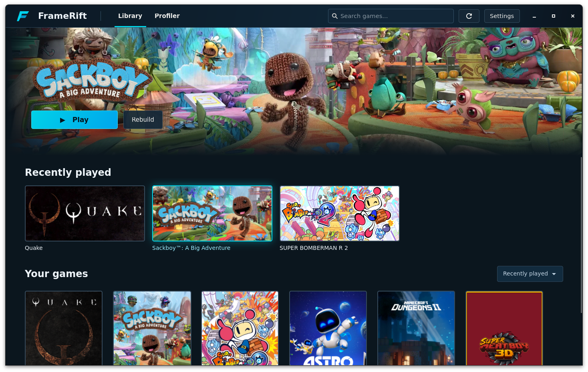

<!--
SPDX-License-Identifier: AGPL-3.0-or-later
Copyright (C) 2026 Michal Sytko and FrameRift contributors
Original project: https://github.com/MichalSy/FrameRift
Additional attribution terms: see NOTICE in the repository root.
-->

# FrameRift

**Launch games. Understand frames.**

FrameRift is an experimental native game library and runtime console for AnyPS5.

**Game execution requires our [modified AnyPS5 fork](https://github.com/MichalSy/AnyPS5). FrameRift only works with this modified version.**

## Features

- Automatic game-folder scanning, metadata titles, search, sorting and recently played games.
- SteamGridDB artwork, an offline SQLite/image cache and animated WebP heroes; API credentials stay in the desktop keyring.
- Linux launch and rebuild, plus a Profiler console with live output and complete session logs. Original games, saves and shared runtime libraries are preserved.

Windows, actual gameplay compatibility and embedded game windows remain unverified. Frame timing, CPU/GPU analysis and controller navigation are planned.

## Build and run

Requires a C++20 compiler, CMake 3.20+, Ninja, pkg-config, GTK4 4.12+, GTK4 VTE 0.70+ (`vte-2.91-gtk4`), SQLite3, libcurl 7.85+, JSON-GLib, GIO, libsecret, libwebp/libwebpdemux and `glib-compile-resources`, including development packages. Game launch also requires Python 3.

```sh
cmake -S . -B build -G Ninja -DCMAKE_INSTALL_PREFIX="$HOME/.local"
cmake --build build
ctest --test-dir build --output-on-failure
./build/framerift
```

In **Settings**, add game folders and configure the modified AnyPS5 checkout, compatible runtime libraries and relinker executable. Save a SteamGridDB API key there to load artwork; `STEAMGRIDDB_API_KEY` overrides the saved key. Cached artwork works offline.

On Linux, `cmake --install build` installs the app, desktop menu entry and icon under the configured prefix. Generated code uses the user cache; saves and session logs use the shared FrameRift data directory, keyed by game ID.

## Library preview



## Documentation

- [Design](docs/design.md) and [architecture](docs/architecture.md)
- [Build dependencies](docs/technical-stack.md) and [platforms](docs/toolkit-and-platforms.md)
- [AnyPS5 integration](docs/anyps5-integration.md) and [game-window integration](docs/game-window-integration.md)
- [Profiling](docs/profiling.md), [input](docs/controller-input.md) and [artwork](docs/artwork.md)
- [Roadmap](docs/roadmap.md), [open questions](docs/decisions-and-open-questions.md) and [image sources](assets/design/README.md)

Contributions are welcome; see [CONTRIBUTING.md](CONTRIBUTING.md).

## License

Original FrameRift code and documentation use [AGPL-3.0-or-later](LICENSE), with the attribution requirement in [NOTICE](NOTICE). Distributed derivatives must provide corresponding source under the AGPL; modified network services must offer their source to users. Preserve the FrameRift credit and original project link.

AnyPS5 remains under [GPL-2.0-only](https://github.com/MichalSy/AnyPS5/blob/main/LICENSE). Third-party artwork and trademarks retain their respective rights and are excluded from FrameRift's license.
