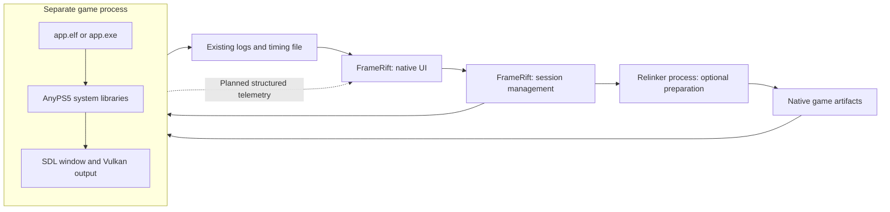

<!--
SPDX-License-Identifier: AGPL-3.0-or-later
Copyright (C) 2026 Michal Sytko and FrameRift contributors
Original project: https://github.com/MichalSy/FrameRift
Additional attribution terms: see NOTICE in the repository root.
-->

# AnyPS5 integration

FrameRift is a separate native application with a game library, Linux conversion/launch and a Profiler console. Windows launch remains unverified. Game execution stays in the native program converted by AnyPS5.

Linux conversion and launch use the [modified AnyPS5 fork](https://github.com/MichalSy/AnyPS5), with a separate game window and Profiler console. Window embedding and structured measurements remain planned. Confirmed upstream details below refer to the pinned [snapshot `197ffac97203d715a258a28b432fa2eedbf8be6f`](https://github.com/boykopovar/AnyPS5/tree/197ffac97203d715a258a28b432fa2eedbf8be6f). Later upstream changes require separate review. Stock upstream AnyPS5 is not a supported substitute for the modified fork.

See also [Profiling](profiling.md), [Controller and input](controller-input.md) and the [project overview](../README.md).

## Confirmed AnyPS5 architecture

AnyPS5 describes itself as a tool for porting executables. Its relinker produces the native output format; AnyPS5 system libraries implement required functions as dynamically loaded libraries. The converted game runs as an ordinary operating-system process, with the PRX libraries loaded into that process. There is no separate AnyPS5 runtime process to which FrameRift can simply submit a game request. Sources: [AnyPS5 README](https://github.com/boykopovar/AnyPS5/blob/197ffac97203d715a258a28b432fa2eedbf8be6f/README.md), [Architecture](https://github.com/boykopovar/AnyPS5/blob/197ffac97203d715a258a28b432fa2eedbf8be6f/docs/dev/ARCHITECTURE.md).

The integration involves three components:

| Component | Confirmed responsibility | FrameRift responsibility |
| --- | --- | --- |
| Relinker | Converts a clean ELF and bundled game modules | Convert missing generated code and support explicit rebuilds. Broader input/option management remains planned. |
| Converted game | Runs as a Linux ELF or Windows EXE | Start it as a separate Linux process and observe its state. Windows launch remains unverified. |
| AnyPS5 system libraries | Loaded by the operating system into the game process | Use an explicitly configured compatible library set. Richer provenance/version tracking remains planned. |

The pinned AnyPS5 documentation requires a clean ELF input. This must not be interpreted as support for arbitrary PS5 packages, SELF containers or their extraction. The relinker converts the inputs it supports; a broader import pipeline would be a separate effort. The launcher passes the original `eboot.bin` to the configured modified relinker, without establishing general package or extraction support. Source: [Relinker usage](https://github.com/boykopovar/AnyPS5/blob/197ffac97203d715a258a28b432fa2eedbf8be6f/docs/user/USAGE.md#input-and-conversion).

## Process separation



FrameRift does not load the game into its GUI process or render the game's Vulkan output through the library view. Native window embedding could change the visible arrangement while preserving the process boundary. Internal communication and window integration are separate interfaces. Timing-file ingestion in the diagram remains planned.

The launch path uses a separate game window. This allows launch work to proceed while embedding is investigated for Windows and Linux. Reliable embedded mode remains an open technical question, not a demonstrated product feature.

## Existing upstream runtime layout

AnyPS5 documents this layout relative to the converted executable:

```text
Game/
    app.elf or app.exe
    libs/
        *.prx
    app0/
        Game resources
        sce_sys/
            param.json
            icon0.png
        sce_module/
            Converted game modules
```

`sce_sys/param.json` and `icon0.png` are resources read by the code; import must check whether they exist. AnyPS5 also permits bundled-module directories named `sce_modules/` or `prx/`. `libs/` contains AnyPS5 system libraries rather than unchanged PS5 modules. A different library search path can be selected during conversion with `--rpath`. AnyPS5 describes game resources as copied separately into `app0/`. Sources: [Runtime layout](https://github.com/boykopovar/AnyPS5/blob/197ffac97203d715a258a28b432fa2eedbf8be6f/docs/user/USAGE.md#runtime-layout), [Metadata paths in code](https://github.com/boykopovar/AnyPS5/blob/197ffac97203d715a258a28b432fa2eedbf8be6f/core/libs/prx/libkernel/AppMetadata/src/AppMetadata.cpp#L24).

The integration uses the fork's [`tools/run_game.py`](https://github.com/MichalSy/AnyPS5/blob/f36da63a8cac9ac8b3bdcad1dd27756850df90cc/tools/run_game.py) with explicit original-game, generated-executable, persistent working-directory and shared-runtime paths. It preserves original resources at their installation path and caches generated code under `framerift/games/<game-id>/`.

Each game has a distinct persistent working directory under the shared data root, separate from the code cache. AnyPS5 resolves its relative save/runtime paths there. Its optional `frame-timing.log` is also relative to that directory; timing import remains planned. FrameRift captures stdout/stderr in a separate session log.

On Windows, AnyPS5 says a locally built library set also needs matching toolchain DLLs in the library directory; release archives include these. A future Windows launcher should diagnose missing files explicitly rather than assume a same-named DLL on the global search path is sufficient. Source: [Windows runtime dependencies](https://github.com/boykopovar/AnyPS5/blob/197ffac97203d715a258a28b432fa2eedbf8be6f/docs/user/USAGE.md#runtime-layout).

## Storage by game ID

- Managed directories use a stable library game ID; display names and original installation-folder names are not path keys.
- The UI displays game titles from metadata, never installation-folder names.
- The game ID remains stable when an installation is renamed or moved.
- Generated code lives under `framerift/games/<game-id>/` in the cache. A versioned layout such as `<cache-root>/<game-id>/<runtime-id>/` is a future proposal, not the current path.
- The persistent game working directory is `<framerift-data-root>/saves/<game-id>/`, independent of runtime version and conversion cache. AnyPS5 creates relative save trees such as `_sd/` and `_sd_mem/` there.
- Captured session logs live under `<framerift-data-root>/logs/<game-id>/<session-id>/`; every launch or rebuild gets its own session directory.
- Saves and captured session logs share one FrameRift data root, with subdirectories created automatically. A configurable data root remains a proposal. Original games and the shared runtime stay at their selected paths.

## Titles, identity and local artwork

AnyPS5 reads `titleId` from `param.json` and a localized `titleName` under `localizedParameters`. Its existing parser prefers the declared default language, then `en-US`, then an available language entry. FrameRift can read the same document but must define its own language selection explicitly. Source: [ParamJsonParser](https://github.com/boykopovar/AnyPS5/blob/197ffac97203d715a258a28b432fa2eedbf8be6f/core/libs/prx/libkernel/AppMetadata/src/ParamJsonParser.cpp#L244).

The scanner uses the metadata title ID as its stable library ID. Supporting multiple versions, conversions or installations of one title may require a separate entry ID, with fields for title ID, installation path, available game version and the selected AnyPS5 library set. That richer identity model remains a proposal.

`icon0.png` is already part of AnyPS5 integration: the runtime uses it as the SDL window icon, and Windows conversion also uses it for EXE resources. Sources: [SDL window icon](https://github.com/boykopovar/AnyPS5/blob/197ffac97203d715a258a28b432fa2eedbf8be6f/core/libs/prx/libSceVideoOut/src/DisplayWindow.cpp#L25), [Windows relinker](https://github.com/boykopovar/AnyPS5/blob/197ffac97203d715a258a28b432fa2eedbf8be6f/core/relinker/main.cpp#L122).

The proposed artwork flow is:

1. Read the local game title and title ID; implemented in the scanner.
2. Record any `icon0.png` as a small status image and local fallback; planned.
3. Match SteamGridDB as the primary source for covers, wide backgrounds and transparent logos. Manual selection taking precedence remains planned.
4. Reuse cached resources offline and fall back to available local images or placeholders when matching fails. Local-icon fallback remains planned; details are in [Artwork](artwork.md).

An app icon does not guarantee a portrait store cover or transparent logo. The examined AnyPS5 metadata/window integration does not establish use of `pic0.png` or `pic1.png`. FrameRift must not assume every game has a complete artwork set and should remain usable without online artwork.

## Conversion and launch profiles

FrameRift should offer documented relinker options deliberately. Examples include Windows output selection, `--to-intel`, `--registry` and `--rpath`. A profile is a FrameRift configuration, not evidence of a new AnyPS5 configuration interface. Exact options and their restrictions are documented in [AnyPS5 USAGE](https://github.com/boykopovar/AnyPS5/blob/197ffac97203d715a258a28b432fa2eedbf8be6f/docs/user/USAGE.md#options).

Proposed profile data includes:

- Relinker and generated native-game paths.
- Working directory and library set.
- Supported conversion options and selected environment variables.
- Input profile and desired window/profiling mode.
- Provenance and version of the artifacts in use.

Replacing PRX libraries does not automatically mean that every existing conversion remains valid or must be rebuilt. FrameRift should record artifact versions and conversion options and display differences. A reliable rule for required reconversion remains to be determined; working library sets should not be replaced automatically without a reason.

## Launch diagnostics and import audit

AnyPS5 already has an import audit. Registry files generated with `--registry` are compared with the exports of built PRX libraries. The audit distinguishes implemented functions, stubs that always throw, missing exports and imports from game modules. It supports JSON output. Source: [Import audit](https://github.com/boykopovar/AnyPS5/blob/197ffac97203d715a258a28b432fa2eedbf8be6f/docs/user/USAGE.md#import-audit).

FrameRift could present this report clearly. A successful import audit confirms only the checked import resolution; it does not promise correct launch, playability or error-free graphics. Design images featuring a particular title are not compatibility evidence either.

The session manager captures process start, stdout, stderr and exit status asynchronously. The UI thread must not wait for a whole game session or a large log file. Future diagnostics should preserve the last known phase on failure: preparation, loader/dependencies, launch or running session. AnyPS5's README documents that unsupported or unexpected states can cause errors and terminate the program. Source: [Error behavior](https://github.com/boykopovar/AnyPS5/blob/197ffac97203d715a258a28b432fa2eedbf8be6f/README.md).

## Game windows and open integration work

The examined runtime creates its own window with `SDL_CreateWindow`. `VideoOutDriver` connects it to the internal AGC/Vulkan output and processes SDL events. These components have no external FrameRift parent-handle interface. Sources: [DisplayWindow](https://github.com/boykopovar/AnyPS5/blob/197ffac97203d715a258a28b432fa2eedbf8be6f/core/libs/prx/libSceVideoOut/src/DisplayWindow.cpp#L52), [Present loop](https://github.com/boykopovar/AnyPS5/blob/197ffac97203d715a258a28b432fa2eedbf8be6f/core/libs/prx/libSceVideoOut/src/VideoOutDriver.cpp#L540).

Later embedding needs at least reliable session-to-window matching, resize/DPI handling, focus, fullscreen and clean detachment on process exit. A pointer to a GUI or SDL window is not a cross-process interface. SDL objects created inside the game process remain there.

The examined AnyPS5 build enables X11 and disables Wayland. This is the concrete starting point for a Linux experiment, not proof that an arbitrary GTK or other GUI window under Wayland can host an external SDL window. Source: [SDL build configuration](https://github.com/boykopovar/AnyPS5/blob/197ffac97203d715a258a28b432fa2eedbf8be6f/CMakeLists.txt#L68).

## Remaining integration experiments

| Experiment | Required result before an implementation decision |
| --- | --- |
| Native launch on both target systems | Launch a prepared game with a defined working directory, logs and exit status. Linux launch is implemented; Windows remains unverified. |
| Library sets | Track versions, dependencies and artifact provenance without modifying original files. |
| Local metadata | Missing or damaged JSON/images produce an understandable library fallback. |
| Windows window integration | Input, resize, DPI, fullscreen and process exit work with the actual SDL/Vulkan window. |
| Linux window integration | Document X11/XWayland behavior separately from any later native Wayland solution. |
| Telemetry | Keep the connection optional; losing it must not block the game. See [Profiling](profiling.md). |

External Linux launch has been checked through opening a game window. This does not confirm playability or the planned embedding and measurement features; the remaining experiments still need validation.
