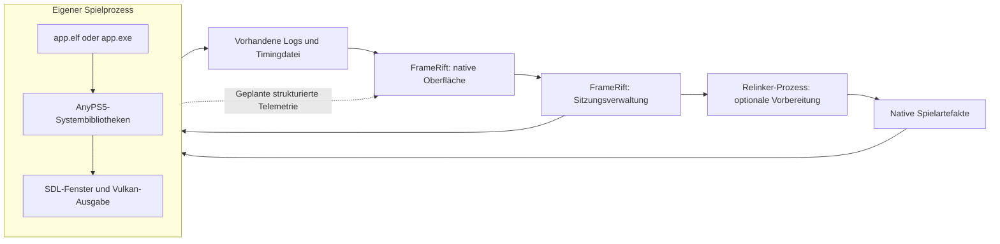

# Integration mit AnyPS5

FrameRift ist als separate native Anwendung für Windows und Linux geplant. Sie soll eine Spielebibliothek, das Starten vorbereiteter Spiele und eine Profiler-Ansicht verbinden. Die eigentliche Spielausführung bleibt bei dem von AnyPS5 konvertierten nativen Programm.

Dieses Dokument beschreibt eine geplante Integration. FrameRift enthält derzeit keine implementierte Laufzeit, keinen Launcher und keine funktionierende Fenstereinbettung. Bestätigte Aussagen über AnyPS5 beziehen sich auf den fest verlinkten [Upstream-Stand `197ffac97203d715a258a28b432fa2eedbf8be6f`](https://github.com/boykopovar/AnyPS5/tree/197ffac97203d715a258a28b432fa2eedbf8be6f). Spätere Upstream-Änderungen müssen gesondert geprüft werden.

Siehe außerdem [Profiling](profiling.md), [Controller und Eingaben](controller-input.md) und die [Projektübersicht](../README.md).

## Bestätigte AnyPS5-Architektur

AnyPS5 beschreibt sich als Werkzeug zum Portieren ausführbarer Programme. Sein Relinker erzeugt das native Ausgabeformat; die AnyPS5-Systembibliotheken implementieren die benötigten Funktionen als dynamisch geladene Bibliotheken. Das konvertierte Spiel läuft als normaler Betriebssystemprozess. Die PRX-Bibliotheken laufen in diesem Spielprozess. Es gibt keinen separaten AnyPS5-Laufzeitprozess, dem FrameRift einfach einen Spielauftrag schicken könnte. Quellen: [AnyPS5 README](https://github.com/boykopovar/AnyPS5/blob/197ffac97203d715a258a28b432fa2eedbf8be6f/README.md), [Architektur](https://github.com/boykopovar/AnyPS5/blob/197ffac97203d715a258a28b432fa2eedbf8be6f/docs/dev/ARCHITECTURE.md).

Für die geplante Integration sind drei Komponenten zu unterscheiden:

| Komponente | Bestätigte Aufgabe | Geplante Aufgabe von FrameRift |
|---|---|---|
| Relinker | Konvertiert ein sauberes ELF und gebündelte Spielmodule. | Spätere Erweiterung: Eingaben und Optionen verwalten, Konvertierung starten und Ergebnisse anzeigen. |
| Konvertiertes Spiel | Läuft als Linux-ELF oder Windows-EXE. | Als eigenen Prozess starten und seinen Zustand beobachten. |
| AnyPS5-Systembibliotheken | Werden vom Betriebssystem in den Spielprozess geladen. | Passenden Bibliothekssatz auswählen und dessen Herkunft dokumentieren. |

Die AnyPS5-Dokumentation verlangt ein sauberes ELF als Eingabe. FrameRift sollte daraus keine bereits vorhandene Unterstützung für beliebige PS5-Pakete, SELF-Container oder deren Extraktion ableiten. Der Relinker konvertiert die von ihm unterstützten Eingaben; eine darüber hinausgehende Importpipeline wäre ein eigenes Vorhaben. Quelle: [Relinker-Nutzung](https://github.com/boykopovar/AnyPS5/blob/197ffac97203d715a258a28b432fa2eedbf8be6f/docs/user/USAGE.md#input-and-conversion).

## Geplante Prozessaufteilung



FrameRift soll den Spielprozess weder in seinen GUI-Prozess laden noch dessen Vulkan-Ausgabe durch die Bibliotheksansicht rendern. Eine native Fenstereinbettung kann die sichtbare Anordnung ändern, lässt aber die Prozessgrenze bestehen. Die interne Kommunikation und die Fensterintegration sind zwei getrennte Schnittstellen.

Der erste nutzbare Startpfad soll auch mit einem eigenen Spielfenster funktionieren. Damit bleiben Spiele startbar, während die Einbettung für Windows und Linux erprobt wird. Ob ein eingebetteter Modus zuverlässig angeboten werden kann, ist eine offene technische Prüfung und kein bereits nachgewiesenes Produktmerkmal.

## Vorhandene Laufzeitstruktur

AnyPS5 dokumentiert diese Struktur relativ zur konvertierten ausführbaren Datei:

```text
Spiel/
    app.elf oder app.exe
    libs/
        *.prx
    app0/
        Spielressourcen
        sce_sys/
            param.json
            icon0.png
        sce_module/
            konvertierte Spielmodule
```

`sce_sys/param.json` und `icon0.png` sind konkrete vom Code gelesene Ressourcen; ihr Vorhandensein ist beim Import zu prüfen. Die Verzeichnisnamen der gebündelten Module können gemäß AnyPS5 auch `sce_modules/` oder `prx/` sein. `libs/` enthält die AnyPS5-Systembibliotheken und nicht die unveränderten PS5-Module. Eine abweichende Bibliothekssuche lässt sich beim Konvertieren mit `--rpath` festlegen. Spielressourcen werden laut AnyPS5 separat nach `app0/` kopiert. Quellen: [Runtime-Layout](https://github.com/boykopovar/AnyPS5/blob/197ffac97203d715a258a28b432fa2eedbf8be6f/docs/user/USAGE.md#runtime-layout), [Metadatenpfade im Code](https://github.com/boykopovar/AnyPS5/blob/197ffac97203d715a258a28b432fa2eedbf8be6f/core/libs/prx/libkernel/AppMetadata/src/AppMetadata.cpp#L24).

FrameRift soll für jedes Spiel ein eindeutiges Arbeitsverzeichnis verwenden. Das ist auch für relative Ressourcenpfade, Eingabekonfiguration und `frame-timing.log` relevant. Zwei parallel laufende Spiele dürfen ihre Logs oder ihre Konfiguration nicht gegenseitig überschreiben.

Unter Windows benötigt ein selbst gebauter Bibliothekssatz laut AnyPS5 außerdem passende Toolchain-DLLs im Bibliotheksverzeichnis. Die Releasearchive enthalten diese bereits. FrameRift soll fehlende Dateien als konkrete Startdiagnose anzeigen, statt vorauszusetzen, dass eine gleichnamige DLL im globalen Suchpfad genügt. Quelle: [Windows-Laufzeitabhängigkeiten](https://github.com/boykopovar/AnyPS5/blob/197ffac97203d715a258a28b432fa2eedbf8be6f/docs/user/USAGE.md#runtime-layout).

## Titel, Identität und lokale Bilder

AnyPS5 liest aus `param.json` das Feld `titleId` sowie einen lokalisierten `titleName` unter `localizedParameters`. Der vorhandene Parser bevorzugt die angegebene Standardsprache, dann `en-US`, anschließend einen vorhandenen Spracheintrag. FrameRift kann dasselbe Quelldokument lesen, muss seine eigene Auswahl nach UI-Sprache aber ausdrücklich definieren. Quelle: [ParamJsonParser](https://github.com/boykopovar/AnyPS5/blob/197ffac97203d715a258a28b432fa2eedbf8be6f/core/libs/prx/libkernel/AppMetadata/src/ParamJsonParser.cpp#L244).

Die Titel-ID soll ein Metadatenmerkmal sein, nicht allein der Primärschlüssel der FrameRift-Bibliothek. Eine Bibliothek kann mehrere Versionen, Konvertierungen oder Installationen desselben Titels enthalten. Geplant ist deshalb eine eigene Eintrags-ID mit separaten Feldern für Titel-ID, Installationspfad, Spielversion soweit verfügbar und verwendeten AnyPS5-Bibliothekssatz.

`icon0.png` ist bereits Bestandteil der AnyPS5-Integration: Die Laufzeit verwendet es als SDL-Fenstericon; der Windows-Konvertierungspfad verwendet das Icon außerdem für die EXE-Ressourcen. Quellen: [SDL-Fenstericon](https://github.com/boykopovar/AnyPS5/blob/197ffac97203d715a258a28b432fa2eedbf8be6f/core/libs/prx/libSceVideoOut/src/DisplayWindow.cpp#L25), [Windows-Relinker](https://github.com/boykopovar/AnyPS5/blob/197ffac97203d715a258a28b432fa2eedbf8be6f/core/relinker/main.cpp#L122).

Für FrameRift ist folgender Datenfluss geplant:

1. Lokalen Titel und lokale Titel-ID einlesen.
2. Vorhandenes `icon0.png` als kleine Statusgrafik und lokale Ersatzquelle erfassen.
3. SteamGridDB als primäre Quelle für Cover, breite Hintergrundbilder und transparente Logos zuordnen; manuelle Auswahl hat Vorrang.
4. Gecachte Ressourcen offline weiterverwenden und bei fehlender Zuordnung auf verfügbare lokale Bilder oder Platzhalter zurückgreifen. Details stehen in [Artwork](artwork.md).

Das App-Icon garantiert kein hochkantiges Store-Cover und kein transparentes Logo. Eine Nutzung von `pic0.png` oder `pic1.png` durch die untersuchte AnyPS5-Metadaten-/Fensterintegration ist nicht belegt. FrameRift soll keine vollständige Artwork-Ausstattung jedes Spiels voraussetzen und lokal jederzeit ohne Online-Artwork funktionieren.

## Konvertierung und Startprofile

FrameRift soll die tatsächlich dokumentierten Relinker-Optionen gezielt anbieten. Dazu zählen unter anderem die Auswahl der Windows-Ausgabe, `--to-intel`, `--registry` und `--rpath`. Ein Profil ist dabei eine FrameRift-Konfiguration; es bedeutet noch keine neue AnyPS5-Konfigurationsschnittstelle. Die genauen Optionen und ihre gegenseitigen Einschränkungen ergeben sich aus [AnyPS5 USAGE](https://github.com/boykopovar/AnyPS5/blob/197ffac97203d715a258a28b432fa2eedbf8be6f/docs/user/USAGE.md#options).

Geplante Profildaten sind:

- Pfad des Relinkers und des erzeugten nativen Spiels.
- Arbeitsverzeichnis und Bibliothekssatz.
- Freigegebene Konvertierungsoptionen und gezielte Umgebungsvariablen.
- Eingabeprofil und gewünschter Fenster-/Profilingmodus.
- Herkunft und Version der verwendeten Artefakte.

Ein Wechsel der PRX-Bibliotheken bedeutet nicht automatisch, dass jede vorhandene Konvertierung gültig bleibt oder neu erstellt werden muss. FrameRift soll Artefaktversionen und Konvertierungsoptionen erfassen und Unterschiede anzeigen. Eine belastbare Regel für nötige Neukonvertierungen ist noch zu ermitteln; ein unbegründetes automatisches Ersetzen funktionierender Bibliothekssätze ist nicht vorgesehen.

## Startdiagnose und Import-Audit

AnyPS5 besitzt bereits ein Import-Audit. Mit `--registry` erzeugte Registerdateien werden mit den Exporten der gebauten PRX-Bibliotheken verglichen. Das Audit unterscheidet implementierte Funktionen, vollständig werfende Stubs, fehlende Exporte und Imports aus Spielmodulen. Es unterstützt JSON-Ausgabe. Quelle: [Import-Audit](https://github.com/boykopovar/AnyPS5/blob/197ffac97203d715a258a28b432fa2eedbf8be6f/docs/user/USAGE.md#import-audit).

FrameRift soll diesen vorhandenen Bericht verständlich anzeigen. Ein erfolgreicher Import-Audit ist eine Aussage über die geprüfte Importauflösung, keine Zusage, dass das Spiel korrekt startet, spielbar ist oder grafisch fehlerfrei funktioniert. Auch Designbilder mit einem konkreten Spieltitel sind keine Kompatibilitätsnachweise.

Die Sitzungsverwaltung soll Prozessstart, Standardausgabe, Fehlerausgabe und Exitstatus asynchron erfassen. Der UI-Thread darf weder auf die vollständige Spielausführung noch auf große Logdateien warten. Bei einem Fehler soll die zuletzt bekannte Phase sichtbar bleiben: Vorbereitung, Loader/Abhängigkeiten, Start oder laufende Spielsitzung. Das README dokumentiert, dass nicht unterstützte oder unerwartete AnyPS5-Zustände Fehler auslösen und das Programm beenden können. Quelle: [Fehlerverhalten](https://github.com/boykopovar/AnyPS5/blob/197ffac97203d715a258a28b432fa2eedbf8be6f/README.md).

## Spielfenster und offene Integration

Die untersuchte Laufzeit erzeugt ihr Fenster selbst mit `SDL_CreateWindow`. `VideoOutDriver` hängt dieses Fenster an die interne AGC/Vulkan-Ausgabe und verarbeitet SDL-Ereignisse. Eine externe FrameRift-Parent-Handle-Schnittstelle ist in diesen Komponenten nicht vorhanden. Quellen: [DisplayWindow](https://github.com/boykopovar/AnyPS5/blob/197ffac97203d715a258a28b432fa2eedbf8be6f/core/libs/prx/libSceVideoOut/src/DisplayWindow.cpp#L52), [Present-Loop](https://github.com/boykopovar/AnyPS5/blob/197ffac97203d715a258a28b432fa2eedbf8be6f/core/libs/prx/libSceVideoOut/src/VideoOutDriver.cpp#L540).

Eine spätere Einbettung benötigt mindestens eine sichere Zuordnung von Spielsitzung zu nativem Fenster, Größen-/DPI-Behandlung, Fokus, Vollbild und sauberes Ablösen bei Prozessende. Ein Speicherzeiger auf ein GUI- oder SDL-Fenster ist keine prozessübergreifende Schnittstelle. Die im Spielprozess erzeugten SDL-Objekte bleiben dort.

Der betrachtete AnyPS5-Build aktiviert X11 und deaktiviert Wayland. Das ist die konkrete Ausgangslage für einen Linux-Spike; daraus folgt keine allgemeine Aussage, dass ein beliebiges GTK- oder anderes GUI-Fenster unter Wayland ein fremdes SDL-Fenster aufnehmen kann. Quelle: [SDL-Buildkonfiguration](https://github.com/boykopovar/AnyPS5/blob/197ffac97203d715a258a28b432fa2eedbf8be6f/CMakeLists.txt#L68).

## Noch zu prüfende Spikes

| Prüfung | Erwartetes Ergebnis vor einer Implementierungsentscheidung |
|---|---|
| Nativer Start auf beiden Zielsystemen | Ein vorbereitetes Spiel lässt sich mit definiertem Arbeitsverzeichnis starten; Logs und Exitstatus sind verfügbar. |
| Bibliothekssätze | Versionen, Abhängigkeiten und Artefaktherkunft lassen sich ohne Veränderung der Quelldateien zuordnen. |
| Lokale Metadaten | Fehlende oder beschädigte JSON-/Bilddateien führen zu einem nachvollziehbaren Bibliotheks-Fallback. |
| Windows-Fensterintegration | Eingaben, Resize, DPI, Vollbild und Prozessende funktionieren mit dem tatsächlichen SDL-/Vulkan-Fenster. |
| Linux-Fensterintegration | X11/XWayland-Verhalten ist getrennt von einer späteren nativen Wayland-Lösung dokumentiert. |
| Telemetrie | Die Verbindung bleibt optional; Verbindungsverlust blockiert das Spiel nicht. Details stehen in [Profiling](profiling.md). |

Diese Spikes sind geplante Untersuchungen. Dieses Repository liefert noch keine entsprechende Laufzeit oder ein überprüftes Integrationsergebnis.
