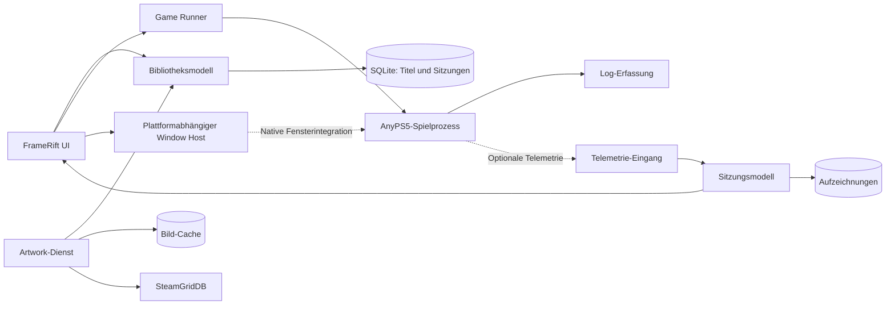

# Architektur

## Ausgangspunkt

FrameRift ist ein separater Desktop-Launcher mit einer Spielebibliothek und einem Performance-Workspace. AnyPS5 erzeugt native Spielprogramme; die Runtime-Module werden im Spielprozess genutzt. Die UI, ihre Datenbank und Artwork-Abfragen sollen im FrameRift-Prozess liegen. Das Spiel behält einen eigenen Prozess, seine Grafik- und Eingabe-Runtime sowie eine klar definierte Lebensdauer.

Diese Trennung erlaubt unabhängige Entwicklung und begrenzt die Anforderungen an AnyPS5. Ein Spiel soll weiter direkt startbar bleiben. Ein optionaler Adapter kann zusätzliche Telemetrie oder Kooperation bei der Fensterdarstellung anbieten. Ein kompletter GUI-Stack muss dafür nicht in die Spiel-Runtime eingebaut werden.

Die hier beschriebene Architektur ist ein Vorschlag. Bestätigte Eigenschaften der vorhandenen Runtime und verifizierte Quellstellen stehen in [AnyPS5-Anbindung](anyps5-integration.md). Die kritische Fensterintegration wird in [Spielfensterintegration](game-window-integration.md) behandelt.

## Prozesse und Datenfluss



Gestrichelte Beziehungen sind besonders von der Runtime oder Plattform abhängig. Der Window Host und die Telemetrie sind getrennte Schnittstellen: Ein extern dargestelltes Spiel kann trotzdem Messdaten liefern. Umgekehrt macht ein eingebettetes Spielfenster noch keine Frame-Analyse möglich.

## Module

### Bibliotheksmodell

Das Modell verwaltet Spiele unabhängig von den UI-Komponenten. Ein Eintrag enthält eine interne ID, vorhandene Titelmetadaten, die ausführbare Ausgabe, das Spielverzeichnis, Startprofile, Artwork-Zuordnungen und den Zeitpunkt des letzten Starts. Eine Titel-ID kann helfen, mehrere Ausgaben desselben Spiels zu erkennen. Sie ersetzt keine interne Identität für unterschiedliche Builds.

Ein Spiel kann mehrere Startprofile besitzen, etwa einen normalen Start und einen instrumentierten Build. FrameRift muss nachvollziehbar anzeigen, welches Programm tatsächlich gestartet wird. Die Auswahl sollte nicht stillschweigend auf eine beliebige ausführbare Datei im Verzeichnis fallen.

Das erste Importverfahren kann explizite Auswahl und Metadatenprüfung verwenden. Ein späterer Scanner arbeitet im Hintergrund und meldet Änderungen an das Modell. Große Verzeichnisbäume und defekte Metadaten dürfen die UI nicht blockieren. Dateisystem-Watcher sind eine Komfortfunktion und kein Ersatz für einen reproduzierbaren Import.

### Game Runner

Der Runner erzeugt aus einem Startprofil einen strukturierten Startauftrag: Programm, Argumentliste, Arbeitsverzeichnis, ausgewählte Umgebungsoptionen und gewünschter Messmodus. Er startet den Prozess, sammelt Standardausgabe und Fehlerausgabe, beobachtet den Exit-Code und führt den Zustand der Sitzung.

Programm und Argumente werden getrennt an die Prozess-API übergeben. Benutzerpfade sind keine zusammengesetzten Shell-Kommandos. Fehler wie eine fehlende ausführbare Datei, ein ungeeignetes Arbeitsverzeichnis oder eine nicht gefundene Runtime-Abhängigkeit werden mit dem tatsächlichen Startkontext erklärt.

Die ersten Versionen sollten fertige AnyPS5-Ausgaben starten. Eine Integration des Relink-/Build-Prozesses ist eine spätere Erweiterung. Falls sie hinzukommt, braucht sie eine eigene Aufgabe mit Fortschritt, Abbruch und Build-Logs; der Start eines vorhandenen Spiels sollte dadurch nicht komplexer werden.

### Window Host

Der Window Host kapselt Betriebssystem-Handles, Größenänderungen, DPI, Fokus und Vollbildübergänge. Seine öffentliche Schnittstelle liefert eine Fähigkeit und einen Zustand, keine toolkitübergreifend gültige Annahme über Fensterbesitz.

Mögliche Zustände sind „externes Fenster“, „Fenster wird verbunden“, „eingebettetes Fenster“ und „Verbindung verloren“. Ein SDL_Window-Zeiger aus dem Spiel ist im Launcher nicht nutzbar. Native Handles dürfen ebenfalls nur im Rahmen der jeweiligen Plattformregeln verwendet werden.

Der Host muss auf Spielende, neu erzeugte Fenster und UI-Größenänderungen reagieren. Ein misslungener Embed-Versuch darf die Prozessverwaltung nicht zerstören. Die externe Darstellung ist ein klar benannter Betriebsmodus; das Produktziel bleibt eine integrierte Spielansicht, deren Tragfähigkeit zuerst bewiesen werden muss.

### Telemetrie-Eingang und Sitzungsmodell

Der Telemetrie-Eingang verarbeitet Nachrichten außerhalb des kritischen UI- und Spielpfads. Eine Sitzung beginnt mit einem Handshake: Protokollversion, Sitzungs-ID, Runtime-Build, verfügbare Messfunktionen und Zeitbasis. Die UI zeigt anschließend nur die tatsächlich angebotenen Messbereiche.

Messpakete brauchen Sequenznummern und eine eindeutige Frame-Zuordnung. CPU- und GPU-Ereignisse können verzögert eintreffen. Das Sitzungsmodell sammelt sie, kennzeichnet unvollständige Frames und stellt eine konsistente Auswahl für Diagramm und Detailanalyse bereit. Fehlende Ereignisse sind ein sichtbarer Datenverlust, kein impliziter Nullwert.

Ein begrenzter Ringpuffer hält Live-Daten. Eine zusätzliche Aufzeichnung schreibt größere Zeiträume auf einen Hintergrundpfad. Bei Überlast darf der Sender Messereignisse nach einer definierten Regel verwerfen und Verluste zählen. UI-Stau oder eine volle Aufzeichnungsqueue dürfen das Spiel nicht unbegrenzt aufhalten.

### Artwork-Dienst

Der Dienst trennt Suche, Auswahl und Bild-Download. Ein automatisch vorgeschlagener SteamGridDB-Treffer wird als Zuordnung gespeichert und kann korrigiert werden. Cache-Einträge referenzieren Asset-ID, Quelle, Variante, Dateiformat und Aktualisierungsinformationen.

Die UI erhält kleine Vorschaubilder und erst bei Bedarf größere Hero-Bilder. Download, Dekodierung und Skalierung großer Grafiken gehören nicht in den UI-Callback. Animierte Bilder haben einen eigenen Lebenszyklus und werden beim Verlassen einer Ansicht beziehungsweise im ruhigen Messmodus pausiert.

## Lokale Speicherung

Vorgeschlagen ist SQLite für strukturierte, eher selten geänderte Daten: Bibliothek, Startprofile, Artwork-Zuordnung, Sitzungsliste und Capture-Metadaten. Der Datenzugriff wird in einem klaren Modul gebündelt. Schemaänderungen erhalten Migrationen; ein Scan überschreibt keine manuelle Artwork-Auswahl.

Hochfrequente Messereignisse gehören in sequenzielle Capture-Dateien oder Blöcke mit separatem Index. Ein einzelner SQL-Schreibvorgang pro GPU-Ereignis auf dem UI-Thread wäre für diesen Zweck ungeeignet. Format, Rotation, Größenlimits und optionale Kompression werden erst nach einem kleinen Telemetrieprototyp festgelegt.

Konfiguration wird von Laufzeitdaten getrennt. Zu unterscheiden sind App-Einstellungen, Spielprofile, Zugangsdaten für SteamGridDB, Bild-Cache und Messaufzeichnungen. API-Schlüssel werden nicht in Capture-Exporte oder normale Diagnose-Logs geschrieben. Betriebssystemgerechte Speicherorte müssen bei der Paketierung festgelegt werden.

## Sitzungszustände

Ein geplanter Zustandsablauf ist:

```text
Bereit → Start wird vorbereitet → Prozess gestartet → Spiel läuft → Prozess beendet
                                      │                  │
                                      ├─ Fensterstatus   ├─ Aufzeichnung an/aus
                                      └─ Telemetriestatus└─ Live-/Frame-Auswahl
```

Fensterstatus, Telemetriestatus und Aufzeichnung sind voneinander unabhängig. Ein Spiel kann laufen, obwohl die Messverbindung abbricht. Eine gespeicherte Aufzeichnung kann nach Spielende weiter analysiert werden. Zur Bibliothek zu navigieren beendet den Prozess nicht automatisch; die konkrete Navigation für eine laufende Sitzung muss eindeutig gestaltet werden.

Die erste Version sollte eine aktive Spielsitzung unterstützen. Mehrere gleichzeitig laufende Spiele würden Prozessauswahl, Fokus, Controller und Telemetrie wesentlich komplizierter machen und sind keine Voraussetzung für das Kernziel.

## Entkopplung von AnyPS5

Ein minimaler Integrationsvertrag ist einer Vielzahl implizit geparster Logzeilen vorzuziehen. Für einen frühen Prototyp kann der Runner vorhandene Logs und Timing-Dateien nutzen. Solche Adapter kennzeichnen die eingeschränkte Messsemantik und ersetzen keine dauerhafte API.

Spätere Änderungen an AnyPS5 sollten klein und unabhängig prüfbar sein: optionaler Telemetrie-Export, Capability-Abfrage oder ein kooperativer Fensteradapter. FrameRift bleibt auch ohne diese Erweiterung als Bibliothek und Launcher sinnvoll nutzbar. Die gemeinsame Weiterentwicklung erfordert keine Zusage, dass AnyPS5-Maintainer eine konkrete Schnittstelle bereits akzeptiert haben.

## Geplante Quellstruktur

Eine mögliche spätere Aufteilung, noch ohne vorhandenen Anwendungsquellcode:

```text
src/
  core/         Bibliothek, Startprofile, Sitzungszustände
  runner/       Prozessstart und Log-Erfassung
  telemetry/    Protokoll, Parser, Puffer, abgeleitete Messwerte
  capture/      Dateiformat, Aufzeichnung, Export
  artwork/      SteamGridDB, Cache und Asset-Auswahl
  platform/     Windows-, X11- und weitere Host-Adapter
  ui/           Bibliothek und Spiel-/Profiler-Ansicht
tests/          Bedeutungsvolle Modell- und Protokolltests
```

Die Architektur soll nachvollziehbare Grenzen schaffen und kein umfangreiches Framework vorwegnehmen. Ein erfolgreicher Spike kann zeigen, dass ein Modul zunächst deutlich kleiner ausfallen darf.
