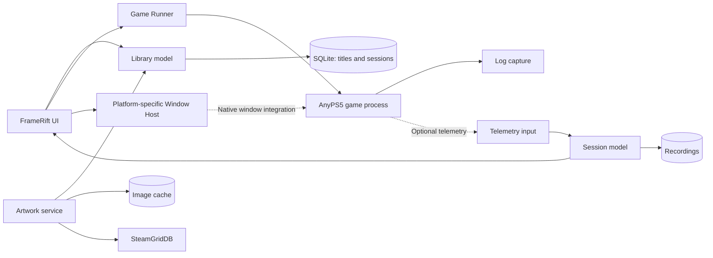

<!--
SPDX-License-Identifier: AGPL-3.0-or-later
Copyright (C) 2026 Michal Sytko and FrameRift contributors
Original project: https://github.com/MichalSy/FrameRift
Additional attribution terms: see NOTICE in the repository root.
-->

# Architecture

## Implementation status

FrameRift implements a GTK4 game library with search, sorting, recently played games, automatic folder scanning, a SQLite/artwork cache and animated heroes. It also provides Settings, Linux launch/rebuild and a Profiler console:

- `src/library` owns game metadata, folder scanning, SQLite access and SteamGridDB requests through libcurl and JSON-GLib. Scans read stable IDs and localized titles from `sce_sys/param.json`, stop at recognized game directories and preserve existing artwork and play history.
- SQLite schema 3 stores configured game folders, installation paths, SteamGridDB IDs, public source pages and artwork paths. Runtime settings use the existing metadata table: AnyPS5 folder, complete compatible patched runtime directory and relinker executable. Installed artwork replaces demo records transactionally after successful loading; user records remain intact.
- `src/ui/app.cpp` connects library selection, search, Settings, Play and tab navigation. `src/ui/profiler` owns an output-only VTE console with bounded scrollback; `src/runtime/log` captures the merged process pipe asynchronously, writes the complete raw log and forwards bounded chunks to the UI. Process completion waits for output to drain. No shell, PTY or file polling is involved. Background tasks handle scanning, downloads and conversion; GTK callbacks update the UI.
- `src/ui/hero` owns banner rendering and WebP playback through libwebpdemux. A GTK tick advances the visible selected animation and the selection crossfade; hidden widgets and disabled GTK animations pause playback. Compressed data, the decoder and the current Cairo frame have explicit ownership; selection keeps only one previous frame for fading.
- `src/runtime` prepares generated code and launches games on Linux through GIO subprocesses. A missing `game.elf` triggers background relinking of the original `eboot.bin` with `--to-intel` and `--recursive-module-search`; generated executables and modules live in the cache under `framerift/games/<game-id>/`. Existing output is reused. The modified AnyPS5 fork's `tools/run_game.py` launcher passes the original resource directory separately from generated code and the shared runtime.
- `src/runtime/bridge` owns a nonblocking loopback UDP socket on its own thread, a bounded event ring and asynchronous command status. `src/runtime/mcp` exposes four tools through a local libsoup HTTP server. GTK samples bridge status every 250 ms; process state alone never marks a game connected. Managed launches receive the UDP endpoint and session identity through their subprocess environment. The [wire protocol](debug-bridge.md) is implemented on the FrameRift side; the AnyPS5 adapter remains separate.
- Rebuild uses the same preparation pipeline with forced conversion, clears generated code for one stable game ID and preserves runtime data and shader caches. It does not spawn the game or update play history. The Profiler shows the result and a bounded conversion-log tail, including converter failures; the full log remains on disk.
- The game runs in a separate process and its own window. Its persistent working directory is `framerift/saves/<game-id>/` under the user data directory; AnyPS5 save trees and runtime data stay separate from generated code. FrameRift observes process exit, records the last-played timestamp after spawning and writes `conversion.log` plus `game.log` at `framerift/logs/<game-id>/<session-id>/` under the same data root.
- `assets/ui` is embedded as GResources. Game artwork comes from the API and is cached outside the repository. Small CTest checks, `library_cache`, `game_launch` and `debug_bridge`, cover persistence, launch, scanning and real UDP/HTTP exchanges without a test framework. CMake installs the executable; on Linux it also installs a desktop menu entry and app icon.

The implemented scope includes the library, external Linux launch, Profiler console and FrameRift's debug/MCP servers. Native UI checks include reaching an external game window; this does not confirm playability. Settings saves the artwork API key through libsecret in the desktop keyring; `STEAMGRIDDB_API_KEY` overrides it. Keyring access and downloads run in background tasks; the key is excluded from game process environments. Window embedding, timing charts and runtime instrumentation remain planned. The following sections describe the target architecture; build commands and release status are in the [README](../README.md).

## Target design

FrameRift is a separate desktop launcher with a game library and a performance workspace. AnyPS5 produces native game programs; its runtime modules run inside the game process. The UI, database and artwork requests belong in the FrameRift process. The game keeps its own process, graphics and input runtime, and a clearly defined lifetime.

This separation supports independent development and limits the requirements placed on AnyPS5. A game should remain directly launchable. An optional adapter could provide telemetry or cooperate with window presentation without adding a complete GUI stack to the game runtime.

The remaining architecture is a proposal. Confirmed runtime properties and verified source references are in [AnyPS5 integration](anyps5-integration.md). [Game-window integration](game-window-integration.md) covers the critical window work.

## Processes and data flow



Dashed relationships depend particularly on the runtime or platform. Window hosting and telemetry are separate interfaces: a game in an external window can still supply measurements. An embedded window alone does not provide frame analysis.

## Modules

### Library model

The model manages games independently of UI components. A future entry could contain an internal ID, available title metadata, the executable output, game directory, launch profiles, artwork mappings and last-launch time. A title ID can help identify different outputs of the same game, but does not distinguish separate builds by itself. The scanner currently uses the metadata title ID as its stable library ID; separate identities for multiple installations remain a proposal.

A game could have several launch profiles, such as a normal launch and an instrumented build. FrameRift must make the selected executable clear rather than silently choosing an arbitrary file in the directory.

The scanner works in the background and reports changes to the model. Large directory trees and damaged metadata must not block the UI. Explicit selection and metadata validation remain useful import steps. Filesystem watchers would be a convenience feature, not a substitute for a reproducible import.

### Game Runner

The runner turns a launch configuration into a structured request: program, argument list, working directory, selected environment options and, eventually, measurement mode. It starts the process, captures stdout and stderr, observes the exit code and tracks session state.

Programs and arguments are passed separately to the process API. User paths are not assembled into shell commands. Errors such as a missing executable, unsuitable working directory or missing runtime dependency are explained using the actual launch context.

The implementation also relinks missing generated code and supports an explicit Rebuild action. Conversion runs as a background task with its own log. Reusing an existing game executable remains a simple launch path; richer build progress and cancellation are possible later extensions.

### Window Host

The planned Window Host encapsulates operating-system handles, resize, DPI, focus and fullscreen transitions. Its public interface reports a capability and a state instead of assuming shared window ownership across toolkits.

Possible states include "external window", "connecting window", "embedded window" and "connection lost". An `SDL_Window` pointer from the game is unusable in the launcher. Native handles must also follow the rules of their platform.

The host must react to game exit, replacement windows and UI resize. A failed embedding attempt must not disrupt process management. External presentation is an explicit operating mode; an integrated game view remains a product goal whose feasibility must first be demonstrated.

### Telemetry input and session model

The planned telemetry input processes messages outside the critical UI and game paths. A session would begin with a handshake containing protocol version, session ID, runtime build, measurement capabilities and time base. The UI would then expose only the measurements actually provided.

Measurement packets need sequence numbers and unambiguous frame correlation. CPU and GPU events may arrive late. The session model would collect them, mark incomplete frames and provide consistent selections for charts and detail analysis. Missing events represent visible data loss, not an implicit zero.

A bounded ring buffer would hold live data. Recording could write longer intervals in the background. Under overload, the sender should follow a defined policy for dropping events and counting losses. A stalled UI or full recording queue must not hold up the game indefinitely.

### Artwork service

The service separates search, selection and image download. An automatically suggested SteamGridDB match is stored as a mapping; manual correction is a future extension. Cache records could later include asset ID, source, variant, format and refresh information.

The UI should receive small previews and larger hero images when needed. Downloading, decoding and scaling large images must not run inside UI callbacks. Animated images have their own lifetime and pause when their view is hidden. A quiet measurement mode could also pause them later.

## Local storage

SQLite already stores the game cache. Other structured, infrequently changed data may include launch profiles, artwork mappings, session lists and capture metadata. Data access stays within its domain. Schema changes need migrations; scans must preserve user artwork choices when those are introduced.

High-frequency measurements belong in sequential capture files or blocks with a separate index. Writing one SQL row per GPU event on the UI thread would be unsuitable. Format, rotation, size limits and optional compression should follow a small telemetry prototype.

Configuration is separate from runtime data. App settings, game profiles, SteamGridDB credentials, artwork caches and recordings have different lifetimes. API keys must not appear in capture exports or ordinary diagnostic logs. Platform-appropriate storage locations must be checked during packaging.

## Session states

A proposed state flow is:

```text
Ready → Preparing launch → Process started → Game running → Process exited
                                │                  │
                                ├─ Window state    ├─ Recording on/off
                                └─ Telemetry state └─ Live/frame selection
```

Window state, telemetry state and recording are independent. A game can keep running after its measurement connection is lost. A saved recording can be analyzed after game exit. Navigating to the library does not end the process; navigation during a running session must make this behavior clear.

The first version should support one active game session. Concurrent games would complicate process selection, focus, controllers and telemetry, and are not required for the core goal.

## Separation from AnyPS5

A small integration contract is preferable to parsing many implicit log formats. Early prototypes can use existing logs and timing files. Such adapters must identify their limited measurement semantics and do not replace a lasting API.

Later AnyPS5 changes should be small and independently verifiable: optional telemetry export, capability discovery or a cooperative window adapter. FrameRift remains useful as a library and launcher without these additions. Joint development does not imply that AnyPS5 maintainers have already accepted a particular interface. Game execution requires the [modified AnyPS5 fork](https://github.com/MichalSy/AnyPS5).

## Source layout

The source tree contains these implemented areas:

```text
src/
  library/      Game metadata, scanning, SQLite cache and SteamGridDB
  runtime/      Conversion, external process launch and direct output capture
  ui/           Native game library, Settings and Profiler console
assets/
  ui/           CSS and app marks
  design/       Reference designs
tests/          Small cache and launch checks
```

Additional domains should appear only when there is a concrete need. Behavior and data stay together; every new file needs a clear domain responsibility. The architecture should make boundaries understandable without building a large framework in advance.
