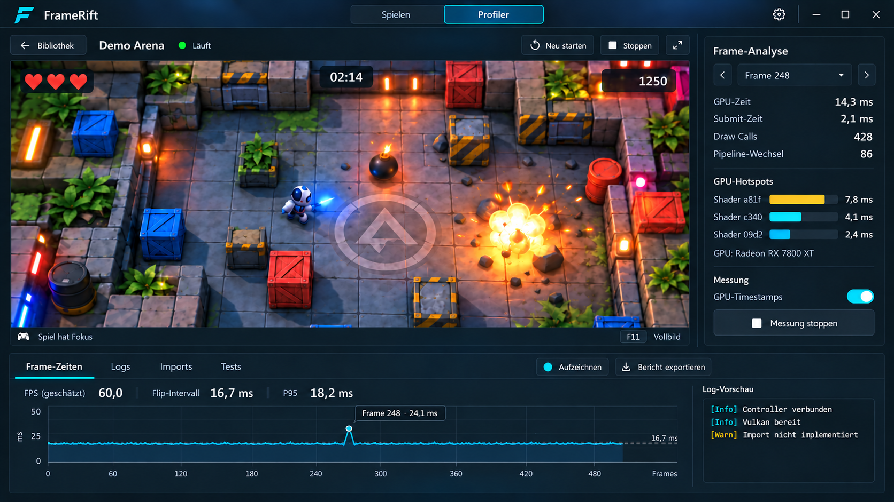

<!--
SPDX-License-Identifier: AGPL-3.0-or-later
Copyright (C) 2026 Michal Sytko and FrameRift contributors
Original project: https://github.com/MichalSy/FrameRift
Additional attribution terms: see NOTICE in the repository root.
-->

# Design and interaction

## Product feel

FrameRift should feel like a modern gaming application with precise analysis tools. The library should be visually appealing and easy to navigate. The profiler should show detailed information while keeping the running game central.

The visual direction uses dark graphite surfaces, restrained separators, compact typography, clear proportions and a cyan accent. The angular F symbol suggests a future app icon. A final vector master, small icon sizes and complete wordmark still need development; the images are not a finished icon package.

The UI is native. Animations should provide short, smooth transitions and immediate feedback. Library artwork may feel lively; analysis tools must remain calm and readable. UI performance needs measurement, especially when the game and profiler run together.

The committed `main` implementation covers the library and cache. Scanning, launching, profiler output, keyring settings and animated heroes are development work. The embedded game view and frame-analysis layout below remain design targets.

## View 1: Library

### Layout and order

1. **Header:** FrameRift branding, search and a few global actions. Keep it compact.
2. **Selected game hero:** Wide artwork, title logo and a clear launch action. A dark gradient keeps text and buttons readable across images.
3. **Recently played:** A row of wide cards before the full collection, providing a quick route back into a game.
4. **Your games:** A denser portrait-cover grid with search, filtering and sorting.

The hero provides visual selection and immediate access; it does not replace a separate details view. A permanently open information column, vertical game list and profiler sidebar do not belong in the library view.

### Selecting and launching a game

Clicking a cover selects the game and updates the hero. In the intended launch flow, **Play** uses the normal game profile. **Launch with profiler** adds the required instrumentation options when the configured modified AnyPS5 runtime supports them. Labels must reflect the actual launch mode and available measurement capabilities.

A context menu or small temporary view can expose the executable, game directory, launch profile, artwork mapping and previous recordings. The default view stays focused on selection and launch.

The development scanning flow imports metadata from configured game folders. Different builds with the same title must remain distinguishable without filling the collection with technical filenames. Display titles come from metadata.

### Proportions

The image shows a possible desktop composition, not required pixel geometry. The hero may become shorter in smaller windows. Keep cover sizes stable and use wider windows for additional grid columns. Avoid oversized buttons and cards; retain useful information density with many titles.

Account for long names, missing logos, very bright images and missing artwork. Cached images and local metadata remain usable offline. Missing artwork should receive a quiet fallback with the title and any available local icon.

## View 2: Game and profiler

### Playing

In the planned integrated view, launching opens a dedicated game view. The game window or surface fills the center. Session actions include stopping the game, returning to the library, opening the profiler, changing presentation and viewing session status.

Library covers do not remain as a large sidebar. Returning to the library must not silently launch a second instance. A running game needs clear status and association with its session.

### Profiler

In the planned **Profiler** layout, game rendering and input remain active. **Frame analysis** appears on the right, with a resizable analysis area below. Splitters should adjust the layout, which can be saved. Analysis panels can close to leave more space for the game.

The right panel should explain the selected frame: frame ID, available CPU/GPU times, submission details and, later, draw calls, pipeline changes or shader/pipeline hotspots. Missing data must display "unavailable" or a specific measurement limit. A ten-second aggregate must not look like a single-frame measurement.

The lower area initially targets **Frame times** and **Logs**. The concept's **Imports** and **Tests** tabs are possible additional tools, outside the established first-version scope. Imports could explain runtime calls and missing symbols; Tests could organize repeatable launches and measurement runs. Their data sources and interaction need separate design. The current development profiler provides console output; frame analysis remains planned.

### Live data and frame selection

The planned timeline initially follows live data. Selecting a frame or time range keeps that selection stable while new data arrives. A visible state distinguishes "Follow live" from "Inspect selection", with a clear action to return to the live end.

Pausing the profiler display does not automatically pause the game. Game pause would require a separate supported runtime interface. A recording must state whether it contains telemetry alone or images too. Saving a frame does not promise deterministic replay.

## Animations, artwork and profiling

Cards may use light hover feedback and subtle selection transitions. Hero changes may briefly crossfade. Sidebars and analysis panels may transition smoothly while remaining immediately usable. Large parallax effects, continuously animated chart backgrounds and constantly jumping numbers would make interaction harder.

SteamGridDB remains the primary artwork source. Animated hero playback is part of the development work; platform support still needs validation. For reproducible measurements, FrameRift should be able to pause its artwork animations or show a still image. See [Artwork](artwork.md).

## Input and accessibility

The library needs complete keyboard navigation with visible focus. Controller navigation is a possible addition; game controller input is considered separately. A focus change must not accidentally trigger a launch.

The profiler must make clear whether keyboard and mouse input controls the game or an analysis field. Search fields and shortcuts must not trigger game actions. Users should be able to deliberately switch focus without leaving the game image. Platform experiments test these transitions.

Account for font and DPI scaling, sufficient text contrast, reduced motion, clear icons with text alternatives and outlier indicators that do not rely solely on color. Small text in the concepts does not define the implementation's minimum font size.

## About the images

Both PNGs show visual targets. They do not demonstrate implemented window integration, an existing telemetry protocol or actual measurements of the depicted game. Sources and ASTRO BOT artwork use are documented in [Image sources](../assets/design/README.md).
