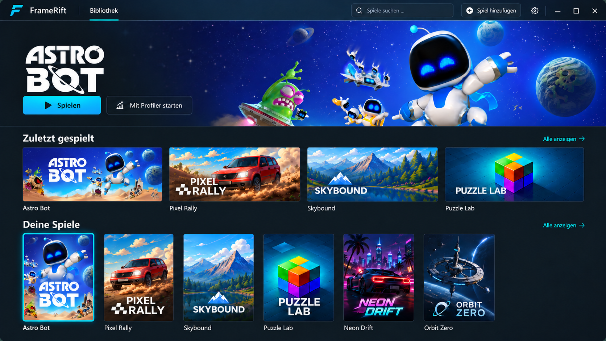
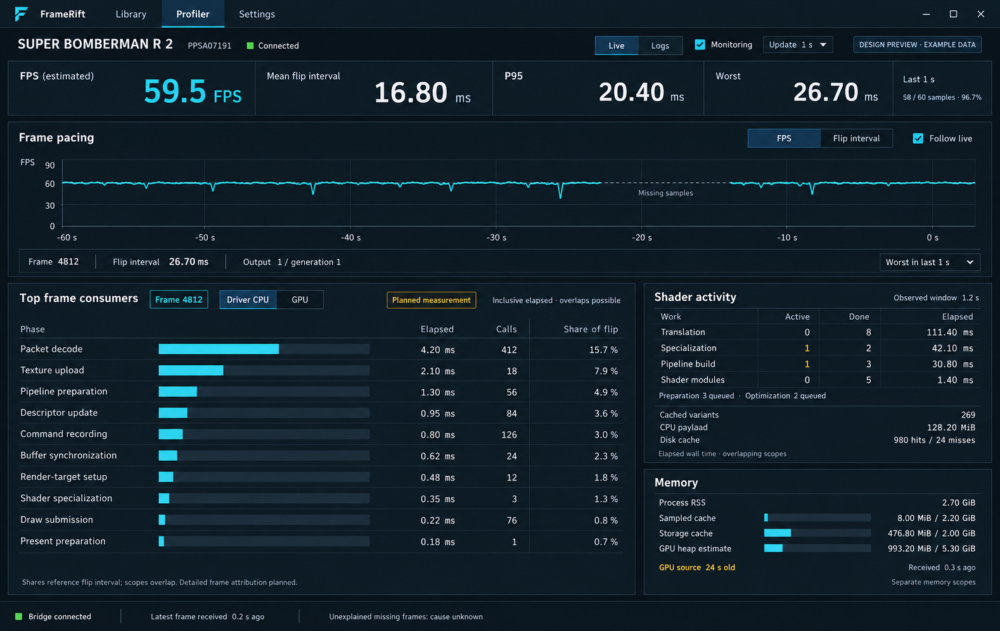

<!--
SPDX-License-Identifier: AGPL-3.0-or-later
Copyright (C) 2026 Michal Sytko and FrameRift contributors
Original project: https://github.com/MichalSy/FrameRift
Additional attribution terms: see NOTICE in the repository root.
-->

# Design and interaction

## Product feel

FrameRift should feel like a modern gaming application with precise analysis tools. The library should be visually appealing and easy to navigate. The profiler should show detailed information while keeping the running game central.

The visual direction uses dark graphite surfaces, restrained separators, compact typography, clear proportions and a cyan accent. The angular F mark is used for the application and installed Linux icon. The reference images describe visual targets; broader icon variants and a complete wordmark remain open.

The UI is native. Animations should provide short, smooth transitions and immediate feedback. Library artwork may feel lively; analysis tools must remain calm and readable. UI performance needs measurement, especially when the game and profiler run together.

The implementation covers the library/cache, automatic folder scanning, Linux launch/rebuild, Profiler console output, local UDP/MCP receiving and game control, Settings with keyring credentials and animated heroes. AnyPS5's optional adapter supplies live flip pacing, shader activity and memory. The native Live dashboard follows profiler-live-v6; detailed frame attribution, captures and saved input scripts remain design targets.

## View 1: Library

### Layout and order

1. **Header:** FrameRift branding, search and a few global actions. Keep it compact.
2. **Selected game hero:** Wide artwork, title logo and a clear launch action. A dark gradient keeps text and buttons readable across images.
3. **Recently played:** A row of wide cards before the full collection, providing a quick route back into a game.
4. **Your games:** A denser portrait-cover grid with search, filtering and sorting.

The hero provides visual selection and immediate access; it does not replace a separate details view. A permanently open information column, vertical game list and profiler sidebar do not belong in the library view.

### Selecting and launching a game

Clicking a cover selects the game and updates the hero. **Play** prepares missing generated code, launches the game in its own window and opens the Profiler console. **Rebuild** recreates generated code without launching, preserving original files, saves and runtime data. A future **Launch with profiler** action could select instrumentation options supported by the configured modified AnyPS5 runtime; measurement profiles are not yet implemented.

A context menu or small temporary view can expose the executable, game directory, launch profile, artwork mapping and previous recordings. The default view stays focused on selection and launch.

The scanning flow imports metadata from configured game folders. Different builds with the same title must remain distinguishable without filling the collection with technical filenames. Display titles come from metadata.

### Proportions

The image shows a possible desktop composition, not required pixel geometry. The hero may become shorter in smaller windows. Keep cover sizes stable and use wider windows for additional grid columns. Avoid oversized buttons and cards; retain useful information density with many titles.

Account for long names, missing logos, very bright images and missing artwork. Cached images and local metadata remain usable offline. Missing artwork should receive a quiet fallback with the title and any available local icon.

## View 2: Profiler workspace

### Live analysis

The current Profiler has **Live** and **Logs** views. The game runs in its external window. A compact session strip identifies process, bridge and monitoring state.

The overview shows estimated FPS and mean/P95/worst flip intervals. A full-width pacing chart defaults to FPS, with a Flip interval toggle and selected-frame footer. Below it, a ten-row consumer table reserves per-frame timing, call counts and share bars. Shader activity and memory occupy the right column. Missing consumer data uses `–` and empty bars; source age and unavailable/stale states remain explicit. The dashboard contains no automation pane.

See [Profiling](profiling.md) for implemented measurement semantics and [native visual review](profiler-design-review.md) for screenshots against the v6 reference. [Profiler workspace and game input scripts](profiler-workspace.md) describes deferred capture and script requirements.

### Input scripts and captures

Saved scripts belong to a stable game ID and can be selected from the Live pane or the game's profile. They run immediately by default, with an optional absolute start frame or delayed start. The editor shows offsets relative to the previous planned action and their target expressions. Snapshot and screenshot checkpoints can be included when the adapter supports them. Saved revisions and observed execution outcomes are shared with the proposed script MCP tools.

Snapshots preserve measurement data; screenshots preserve pixels with actual capture frame IDs. Neither promises a game save state or deterministic replay. Their directory layout, asynchronous completion and loss semantics are defined in the workspace specification.

### Stable inspection

The timeline initially follows live data. Selecting a frame switches to **Inspect selection** and preserves that selection while new data arrives. **Follow live** returns to the live end. Inspecting the view does not pause the game. Existing process controls and logs remain available without a telemetry connection; scripts remain editable offline.

Embedded game presentation remains a separate [window-integration](game-window-integration.md) proposal. The additional [game-surface concept](../assets/design/profiler.png) illustrates that possible layout, without establishing native integration.

## Animations, artwork and profiling

Cards may use light hover feedback and subtle selection transitions. Hero changes may briefly crossfade. Sidebars and analysis panels may transition smoothly while remaining immediately usable. Large parallax effects, continuously animated chart backgrounds and constantly jumping numbers would make interaction harder.

SteamGridDB remains the primary artwork source. Animated WebP hero playback is implemented; Windows playback remains unverified. For reproducible measurements, FrameRift should be able to pause its artwork animations or show a still image. See [Artwork](artwork.md).

## Input and accessibility

The library needs complete keyboard navigation with visible focus. Controller navigation is a possible addition; game controller input is considered separately. A focus change must not accidentally trigger a launch.

The profiler must make clear whether keyboard and mouse input controls the game or an analysis field. Search fields and shortcuts must not trigger game actions. Users should be able to deliberately switch focus without leaving the game image. Platform experiments test these transitions.

Account for font and DPI scaling, sufficient text contrast, reduced motion, clear icons with text alternatives and outlier indicators that do not rely solely on color. Small text in the concepts does not define the implementation's minimum font size.

## About the images

The design PNGs show visual targets, with example metrics. They are distinct from native screenshots and do not demonstrate implemented per-frame attribution, captures, input scripts or native window integration. The new workspace references use empty screenshot placeholders and contain no generated game artwork. Sources, prompts and ASTRO BOT artwork use in the library concept are documented in [Image sources](../assets/design/README.md).
