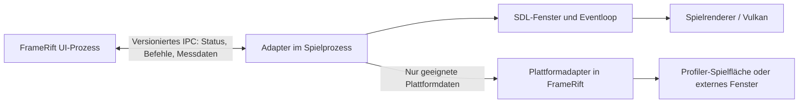

# Integration des Spielprozesses und seines Fensters

[Zur Projektübersicht](../README.md) · [Toolkit und Plattformen](toolkit-and-platforms.md) · [Artwork](artwork.md)

## Ziel und Status

FrameRift soll ein laufendes Spiel aus einem **separaten Prozess** in einer eigenen Profiler-Ansicht darstellen können. Die große Spielfläche, die Frame-Analyse rechts und die Messansicht unten sind das gewünschte Layout. Die eingebettete Darstellung ist ein geplantes Ziel mit plattformabhängigen Prüfungen; sie ist noch keine nachgewiesene Produkteigenschaft.

Die Architektur soll außerdem eine externe Spielansicht unterstützen. Damit bleiben Start, Prozessverwaltung und Profiler bedienbar, auch wenn ein bestimmtes System oder ein Spiel-Build kein verlässliches Einbetten erlaubt.

## Grundmodell und Besitz

Der Spielprozess besitzt sein SDL-Fenster, seine Eingabe-Verarbeitung und seine Grafikressourcen. FrameRift besitzt die Bibliothek, den Prozess-Controller, Profiler-Datenmodelle und die UI-Flächen. Ein Integrationsadapter vermittelt zwischen beiden, ohne die Spielausführung in den UI-Prozess zu verlagern.

**Ein `SDL_Window*` darf niemals über die Prozessgrenze übergeben und im anderen Prozess benutzt werden.** Der Zeiger verweist auf Speicher des erzeugenden Prozesses. Dasselbe gilt für `Display*`, `wl_display*`, `wl_surface*` und beliebige Vulkan-Objektzeiger. Auch eine numerische Serialisierung einer Adresse macht daraus kein gemeinsam nutzbares Objekt.

Ein Windows-`HWND` oder eine X11-`Window`-ID ist dagegen ein Betriebssystem-/Serverbezug, der unter den jeweiligen Plattformbedingungen zur Identifikation dienen kann. Diese Werte dürfen nur zusammen mit Prozessidentität, Backend und Lebenszeitgeneration ausgewertet werden. GPU-Ressourcen verlangen ausdrücklich exportierbare Handles und einen eigenen Synchronisationsvertrag.

## Gegenwärtiger AnyPS5-Ausgangspunkt

Die untersuchte Upstream-Fassung ist [AnyPS5, Commit 197ffac97203d715a258a28b432fa2eedbf8be6f](https://github.com/boykopovar/AnyPS5/tree/197ffac97203d715a258a28b432fa2eedbf8be6f). Ihr [CMakeLists.txt](https://github.com/boykopovar/AnyPS5/blob/197ffac97203d715a258a28b432fa2eedbf8be6f/CMakeLists.txt#L68) konfiguriert SDL aus `3rdparty/SDL2` mit `SDL_SHARED=OFF`, `SDL_STATIC=ON`, `SDL_X11=ON`, `SDL_WAYLAND=OFF` und Vulkan-Unterstützung.

Die [Fenstererzeugung in DisplayWindow.cpp](https://github.com/boykopovar/AnyPS5/blob/197ffac97203d715a258a28b432fa2eedbf8be6f/core/libs/prx/libSceVideoOut/src/DisplayWindow.cpp#L63) verwendet die SDL2-Signatur von `SDL_CreateWindow()` und später `SDL_GetWindowWMInfo()`. Das bestätigt den SDL2-Ausgangspunkt zusätzlich zum Verzeichnisnamen.

Das ist eine Quellcodebeobachtung für diesen Commit. Ein fertiges Release-Artefakt, eine andere Konfiguration oder ein zukünftiger Upstream kann abweichen. Für eine spätere Integration ist der konkrete ausgelieferte Build maßgeblich.

Für diesen SDL2-Ausgangspunkt stellt `SDL_GetWindowWMInfo()` backendabhängige Informationen bereit. SDL2 kennt zudem `SDL_CreateWindowFrom()` zum Umhüllen eines vorhandenen nativen Fensters; diese API ist kein Mechanismus, einen `SDL_Window*` zwischen Prozessen zu teilen. [SDL2 GetWindowWMInfo](https://wiki.libsdl.org/SDL2/SDL_GetWindowWMInfo), [SDL2 CreateWindowFrom](https://wiki.libsdl.org/SDL2/SDL_CreateWindowFrom)

SDL3 ist eine mögliche spätere Zielvariante. Dort werden native Angaben über `SDL_GetWindowProperties()` abgefragt. SDL2- und SDL3-Adapter müssen getrennte ABI-/API-Verträge besitzen; eine SDL3-Dokumentation bestätigt keine SDL2-Funktion. [SDL3 GetWindowProperties](https://wiki.libsdl.org/SDL3/SDL_GetWindowProperties)

## Bevorzugte Integrationsrichtung: kooperativer Adapter

Ein kleiner, gezielt integrierter Adapter im Spielprozess ist die vorgeschlagene bevorzugte Richtung. Er kann an der tatsächlichen Fenstererzeugung mitwirken, passende native Daten liefern und Ereignisse über ein versioniertes IPC-Protokoll melden. Er ist nachvollziehbarer als das Erraten eines Fensters anhand eines Titels.

Der Adapter soll konzeptionell:

1. Einen von FrameRift gestarteten Prozess anhand eines Sitzungsbezugs erkennen.
2. Die tatsächliche SDL-Fenstererzeugung melden und das verwendete Video-Backend angeben.
3. Die unterstützten Fähigkeiten melden, etwa externe Darstellung, Windows-Handle, X11-ID oder optionalen Bildtransport.
4. Größen-, Fokus-, Vollbild- und Beendigungsereignisse bestätigen.
5. Sich nach einem Abbruch ohne unendliches Warten oder übrig gebliebene UI-Ressourcen beenden.

Das ist ein Protokollentwurf, kein bereits vorhandener Adapter. Die Bibliothek muss auch mit einem unmodifizierten Spielprozess funktionieren, dann zunächst über das externe Fenster.

## Hook-Richtung als geprüfte Alternative

Ein Hook an `SDL_CreateWindow` kann die Fenstererzeugung beobachten oder in einem kontrollierten Adapter koordinieren. **Dieser Hook läuft im Spielprozess.** FrameRift empfängt daraus Plattformdaten und Status über IPC. Das Frontend ruft nicht nachträglich eine fremde SDL-Instanz über deren Speicheradresse auf.

Weitere Eintrittspunkte wie spätere Fensterneuerzeugung, Fensterzerstörung und backendabhängige Resize-/Fullscreen-Abläufe müssen mit erfasst werden. Ein einmal erfolgreich abgefangenes `SDL_CreateWindow` beweist noch keinen vollständigen Lebenszyklus. SDL weist insbesondere auf die Kopplung von Fenstern und Grafik-Backends hin. [SDL2 CreateWindow](https://wiki.libsdl.org/SDL2/SDL_CreateWindow)

### Linux: Interposition nur unter überprüfbaren Bedingungen

`LD_PRELOAD` ist **kein zugesagter universeller SDL-Hook**. Vor diesem Weg müssen am konkreten Prozessartefakt überprüft werden:

- Ist SDL dynamisch geladen oder in ein ausführbares Programm bzw. eine andere Bibliothek integriert?
- Erfolgt der betreffende Aufruf über eine interponierbare dynamische Symbolauflösung?
- Sind Sichtbarkeit, Symbolversionen, Relokationen und Aufrufstellen für den Adapter geeignet?
- Haben Linkeroptionen, Optimierungen, lokale Bindung oder LTO die relevante Grenze verändert?
- Stimmt die ABI des Hooks exakt mit der benutzten SDL-Version und Architektur überein?
- Wird die Adapterbibliothek für diesen kontrollierten Start tatsächlich geladen, und erreicht ein Nachweistest den Hook?

Die GNU-Linker-Dokumentation zeigt beispielsweise, dass `-Bsymbolic` und `-Bsymbolic-functions` Referenzen innerhalb eines Shared Objects an dessen eigene Definitionen binden können. Das ist ein konkreter Grund, nicht vom bloßen Vorhandensein eines Symbolnamens auf Hookbarkeit zu schließen. [GNU ld: Symbolbindung](https://sourceware.org/binutils/docs/ld/Options.html)

Das statisch eingebundene SDL im untersuchten AnyPS5-Quellstand spricht gegen die pauschale Annahme, ein Preload-Wrapper für eine externe SDL-Bibliothek fange alle Aufrufe ab. **Statisches SDL bedeutet aber nicht, dass überhaupt kein Hook oder Adapter möglich ist.** Ein bewusst eingebauter Adapter, ein linkerbasierter Buildweg oder eine getrennt bewertete native API-Grenze können andere Möglichkeiten eröffnen. Ein niedrigerer Hook an der Fensterplattform verändert jedoch die Reichweite und braucht seine eigene Analyse. Binärpatching und Injektion sind keine beschlossene Basisarchitektur.

### Windows: keine pauschale DLL-Annahme

Auch auf Windows entscheidet der konkrete Build, ob eine importierte SDL-DLL-Funktion, ein kooperativer Adapter oder eine andere kontrollierte Grenze verfügbar ist. Statische SDL-Nutzung liefert keinen automatischen IAT-Eintrag für `SDL_CreateWindow`. Der erste Prototyp soll daher den kooperativen Prozess testen und seine Fensterdaten explizit melden, bevor ein unmodifizierter Fremdprozess mit Hooks unterstützt wird.

## Plattformmatrix

| Umgebung | Nutzbarer Bezug | Vorgeschlagener Integrationsweg | Status |
|---|---|---|---|
| Windows / Win32 | `HWND` und bestätigte Prozess-/Fensteridentität | Plattformadapter; Qt-Fremdfenstercontainer als Kandidat | Nachzuweisen |
| Linux / X11 | X11-`Window`-ID auf demselben X-Server | Reparent/Container mit Fokus- und Geometrievertrag | Nachzuweisen |
| Linux / natives Wayland | Keine universell übertragbare Fremdfenster-ID zum Reparenten | Kooperativer Bildtransport oder externe Darstellung | Eigenes Entscheidungsgate |
| Linux / XWayland | X11-Ressource innerhalb XWayland | Nur wenn auch der Hostweg tatsächlich kompatibel ist | Gesondert testen |
| Alle Zielplattformen | Prozess und IPC | Externes Spielwindow plus Profiler | Vorgesehener Fallback |

## Windows: HWND-Einbettung

Win32 kennt `SetParent()` auch für Fenster aus unterschiedlichen Prozessen. Es ändert Fensterstyles nicht automatisch. Microsoft dokumentiert zudem Probleme bei unterschiedlichen DPI-Awareness-Modi, einschließlich einer möglichen erzwungenen Änderung des Kindprozesses. [SetParent](https://learn.microsoft.com/en-us/windows/win32/api/winuser/nf-winuser-setparent)

Für FrameRift sind deshalb folgende Aufgaben vorgeschlagen:

- Ein eindeutiges Hostrechteck in der Profiler-Ansicht schaffen.
- Elternbeziehung, Styles und bisherige Fenstergeometrie kontrolliert verwalten.
- Größen in UI-Koordinaten und tatsächlichen Spielpixeln unterscheiden.
- DPI-Verhalten des gestarteten Spielprozesses und des Frontends vor der Einbettung abstimmen.
- Tastaturfokus, Mauskapture, relative Maus und Controller-Verhalten getrennt prüfen.
- Vollbild, Minimieren, Wiederherstellen und Fensterneuerzeugung als Lebenszyklusereignisse behandeln.
- Erst den Spielprozess beenden oder das Fenster geordnet lösen, bevor der Host zerstört wird.

Qt kann mit `QWindow::fromWinId()` einen geeigneten fremden Handle repräsentieren. Die API kann bei fehlender Unterstützung `nullptr` liefern und ist keine allgemeine Fernsteuerung des Fensters. [Qt Fremdfenster](https://doc.qt.io/qt-6/qwindow.html#fromWinId)

Bei Qt Quick kann `WindowContainer` das Rechteck verwalten. Sein natives Kindfenster liegt über gewöhnlichen Quick-Items; ein gezeichnetes Panel darf daher nicht einfach als Overlay über den Spielinhalt geplant werden. [Qt WindowContainer](https://doc.qt.io/qt-6/qml-qtquick-windowcontainer.html)

## Linux: X11 und XWayland

X11 kennt serverseitige Fensterressourcen und `XReparentWindow()`. Diese Grundlage erlaubt die Untersuchung eines prozessübergreifenden Containers auf demselben X-Server. Eine X11-ID allein löst jedoch Fokus, Eventrouting, Visual-/Renderer-Anforderungen und Zerstörung nicht. [Xlib-Fensterfunktionen](https://www.x.org/releases/current/doc/libX11/libX11/libX11.html)

Für FrameRift ist vorgeschlagen, X11 zunächst mit einem kooperativen SDL2/Vulkan-Testprozess zu validieren. Dabei werden Fensterneuerzeugung, Fokuswechsel, Resize und eine unveränderte Spielbildausgabe geprüft. Der Adapter verarbeitet SDL-Ereignisse weiterhin im Spielprozess.

Ein Wayland-Desktop mit XWayland ist ein zusätzlicher Fall. Das untersuchte AnyPS5 nutzt aufgrund seiner SDL-Konfiguration voraussichtlich den X11-Pfad, falls dieser verfügbar ist; dies ist am gestarteten Build zu bestätigen. Ein nativ auf Wayland laufendes GTK-/Qt-Hostfenster ist nicht automatisch ein kompatibler X11-Elterncontainer. Ein erzwungener X11-Hostmodus ist deshalb höchstens eine dokumentierte Option, keine unsichtbare Universallösung.

## Linux: natives Wayland als eigenes Gate

Wayland-Oberflächen gehören zur jeweiligen Clientverbindung. Der Basismodellbeschreibung zufolge kennen Clients nicht die globale Position ihrer Oberflächen und können nicht auf die Oberflächen anderer Clients zugreifen. Das unterscheidet sich grundlegend von einem allgemeinen X11-Reparenting. [Wayland-Protokollmodell](https://wayland.freedesktop.org/docs/book/Protocol.html)

Das optionale `xdg-foreign`-Protokoll kann eine exportierte Toplevel-Referenz übertragen und Beziehungen zwischen Oberflächen herstellen, beispielsweise für externe Dialoge. Es definiert damit keinen beliebigen Spielviewport, den ein anderer Prozess in seine UI-Szene ziehen kann. [Offizielle xdg-foreign-Protokolldefinition](https://gitlab.freedesktop.org/wayland/wayland-protocols/-/blob/main/unstable/xdg-foreign/xdg-foreign-unstable-v2.xml)

Vor dem Beschluss einer nativen Wayland-Einbettung muss ein eigener Nachweis beantworten:

1. Welche konkreten Compositoren und Protokolle werden benötigt?
2. Wer erzeugt die sichtbare Oberfläche und wer besitzt ihre Buffer?
3. Wie gelangen die Spielbilder in die FrameRift-Szene?
4. Wer empfängt Eingabe, und wie wird ein kontrollierter Fokuswechsel umgesetzt?
5. Wie funktionieren Resize, Fractional Scaling und unterschiedliche Monitore?
6. Was passiert bei fehlendem Protokoll, Rendererwechsel oder Verbindungsabbruch?

Solange diese Fragen nicht mit einem funktionierenden Prototyp beantwortet sind, bleibt die externe Spielansicht der geplante Wayland-Fallback. Eine Toolkitentscheidung allein kann dieses Gate nicht schließen.

## Alternative: gemeinsam nutzbare GPU-Bilder

Ein kooperativer Renderer könnte Spielbilder in exportierbare Ressourcen schreiben, die FrameRift importiert und als Bestandteil seiner UI darstellt. Damit werden normale UI-Überlagerungen und Clipping grundsätzlich anders lösbar als mit einem fremden Kindfenster. Dieser Weg wäre jedoch eine eigene Renderer-/Adapterentwicklung.

Vulkan unterscheidet externe Speicherressourcen und externe Synchronisation. Die API bietet plattformspezifische FD- beziehungsweise Win32-Handle-Wege und Capability-Abfragen. Ein Speicherhandle genügt ohne passenden Synchronisationsvertrag nicht. [Vulkan: External Memory and Synchronization](https://docs.vulkan.org/guide/latest/extensions/external.html)

Der vorgeschlagene Vertrag muss zusätzlich Format, Farbraum, Abmessungen, Adapter/GPU, Besitz der Handles, Abschluss der Schreiboperationen und Freigabe alter Bilder definieren. Ein Wechsel zwischen Vulkan-Spielrenderer und einem anderen UI-Backend darf nicht als kostenloser Import angenommen werden. Die Hardware- und Treiberkombination muss den tatsächlich gewählten Pfad unterstützen.

Die Wirkung auf Profiling ist separat zu messen: Zusätzliche Präsentation, Kopien oder Synchronisation können die ermittelten Zeiten verändern. Ein Screenshot oder CPU-Readback pro Frame ist höchstens ein begrenzter Diagnose-/Fallback-Weg und kein versprochener performanter Live-Transport.

## Vorgeschlagener IPC-Vertrag

Das folgende Schema ist Planungsinhalt und noch keine API:

| Nachrichtengruppe | Beispielinhalt | Zweck |
|---|---|---|
| Handshake | Protokollversion, Sitzung, Prozessidentität, Backend, Fähigkeiten | Falsche Versionen oder Prozesse erkennen |
| Fensterstatus | Erzeugt, ersetzt, zerstört, Generation, nativer Bezug | Veraltete Fensterdaten nicht weiterbenutzen |
| Darstellung | Viewportgröße, Pixeldichte, Präsentationsmodus, Bestätigung | UI und Spielrenderer koordinieren |
| Fokus | Wechselanfrage und bestätigter Zustand | UI-Shortcuts und Spieleingabe trennen |
| Prozesszustand | Startet, läuft, beendet, Fehler | Klare Benutzerzustände ohne Hängen |
| Profiler | Zeitbasis, Frame-ID, Messpunkt, Messquelle | Zahlen richtig zuordnen |
| Optionaler Bildtransport | Format, Generation, Ressource, Sync-Zustand | Kontrollierter GPU-Sharing-Pfad |

Der Transport wird nach Toolkit- und Plattformprüfung ausgewählt. Named Pipes oder lokale Sockets sind mögliche Richtungen. Alle Nachrichten erhalten Längenbegrenzungen und klaren Besitz; interne Speicheradressen sind kein Datenformat.

## Lebenszyklus und externer Fallback

Der vorgeschlagene Ablauf lautet: Spiel starten, Adapterfähigkeit prüfen, Spielfenster abwarten, geeigneten Darstellungsweg auswählen, Profiler öffnen. Fehlt eine bestätigte Embed-Fähigkeit, bleibt das Spiel in seinem eigenen Fenster. Ein fehlgeschlagener Einbettungsversuch soll einen lesbaren Zustand liefern und nicht den Start blockieren.

Der Prozess-Controller muss ohne blockierenden UI-Wait auf das Ende reagieren. GIO bietet dafür im GTK-Weg unter anderem asynchrone Subprocess-Operationen; bei Qt wird der entsprechende Qt-Prozessweg bewertet. Ein Abbruchwunsch ist vom bestätigten Prozessende zu unterscheiden. [GIO Subprocess](https://docs.gtk.org/gio/class.Subprocess.html)

Ein normaler Abschluss kehrt zur Bibliothek zurück und aktualisiert deren lokalen zuletzt-gespielt-Zustand. Ein Crash zerstört keine Bibliotheksdaten. Unverfügbare Messwerte werden als unverfügbar angezeigt; FrameRift erfindet keine Frame-Analyse aus einem bloßen sichtbaren Fenster.

## Vorgeschlagene Nachweise vor Umsetzung

| Prüfung | Erwartetes Ergebnis |
|---|---|
| Windows, kompatible und abweichende DPI-Modi | Verhalten dokumentiert; kein unbemerkter Darstellungsbruch |
| X11 mit SDL2/Vulkan | Fenster zuverlässig identifiziert, Größe und Eingabe erhalten |
| XWayland und nativer Wayland-Host | Kompatibilitätsgrenze sichtbar; externer Fallback funktioniert |
| Natives Wayland | Separates Ergebnis statt einer X11-Erfolgsannahme |
| Wiederholtes Resize/Fullscreen/Monitorwechsel | Kein veralteter Handle und kein zerstörter Host |
| Spielende, Crash, Frontendende | Eindeutige Besitz- und Aufräumreihenfolge |
| Frontend-Animation und Profiler-Aktualisierung | Zusätzliche CPU-/GPU-Last nachvollziehbar |
| Hook bei abweichendem Build | Fehlende Hookfähigkeit erkannt; kein Startzwang |
| GPU-Sharing, falls gewählt | Capability-, Format-, Sync- und Messkosten belegt |

Die Fensterintegration ist ein früher Architekturtest. Die vollständige Bibliothek und der Profiler sollen erst auf einer nachgewiesenen Plattformstrategie aufbauen.
