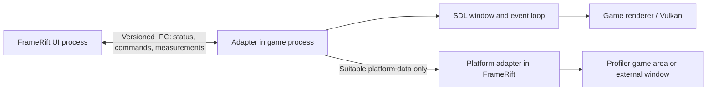

<!--
SPDX-License-Identifier: AGPL-3.0-or-later
Copyright (C) 2026 Michal Sytko and FrameRift contributors
Original project: https://github.com/MichalSy/FrameRift
Additional attribution terms: see NOTICE in the repository root.
-->

# Game process and window integration

[Project overview](../README.md) · [Toolkit and platforms](toolkit-and-platforms.md) · [Artwork](artwork.md)

## Goal and status

FrameRift is intended to display a running game from a **separate process** in its Profiler view. The desired layout has a large game area, frame analysis on the right and measurements below. Embedded rendering is planned and requires platform-specific validation; it is not a proven product feature.

The committed application on `main` provides the library and artwork cache. Process launching and a Profiler output view are development work. The architecture must also support an external game window so that launching, process management and profiling remain usable when a system or game build cannot embed reliably.

## Basic model and ownership

The game process owns its SDL window, input handling and graphics resources. FrameRift owns the library, process controller, Profiler data models and UI areas. An integration adapter connects them without moving game execution into the UI process.

**Never pass an `SDL_Window*` across the process boundary and use it in the other process.** It points to memory in the process that created it. The same applies to `Display*`, `wl_display*`, `wl_surface*` and Vulkan object pointers. Serializing an address as a number does not make the object shareable.

A Windows `HWND` or X11 `Window` ID is an operating-system or server reference that can identify a window under the relevant platform conditions. These values must be checked together with process identity, backend and lifetime generation. GPU resources require explicitly exportable handles and a separate synchronization contract.

## AnyPS5 baseline

The inspected upstream version is [AnyPS5, commit 197ffac97203d715a258a28b432fa2eedbf8be6f](https://github.com/boykopovar/AnyPS5/tree/197ffac97203d715a258a28b432fa2eedbf8be6f). Its [CMakeLists.txt](https://github.com/boykopovar/AnyPS5/blob/197ffac97203d715a258a28b432fa2eedbf8be6f/CMakeLists.txt#L68) configures SDL from `3rdparty/SDL2` with `SDL_SHARED=OFF`, `SDL_STATIC=ON`, `SDL_X11=ON`, `SDL_WAYLAND=OFF` and Vulkan support.

[Window creation in DisplayWindow.cpp](https://github.com/boykopovar/AnyPS5/blob/197ffac97203d715a258a28b432fa2eedbf8be6f/core/libs/prx/libSceVideoOut/src/DisplayWindow.cpp#L63) uses the SDL2 signature of `SDL_CreateWindow()` and later calls `SDL_GetWindowWMInfo()`. This confirms the SDL2 baseline beyond the directory name.

These are source observations for that commit. Release artifacts, other configurations and future upstream versions may differ. Integration must be assessed against the actual distributed build. FrameRift's launcher requires the [modified AnyPS5 fork](https://github.com/MichalSy/AnyPS5); the upstream references here document the window-system baseline.

For SDL2, `SDL_GetWindowWMInfo()` provides backend-specific information. `SDL_CreateWindowFrom()` wraps an existing native window; it does not share an `SDL_Window*` between processes. [SDL2 GetWindowWMInfo](https://wiki.libsdl.org/SDL2/SDL_GetWindowWMInfo), [SDL2 CreateWindowFrom](https://wiki.libsdl.org/SDL2/SDL_CreateWindowFrom)

SDL3 is a possible future target. It exposes native information through `SDL_GetWindowProperties()`. SDL2 and SDL3 adapters need separate ABI/API contracts; SDL3 documentation does not establish an SDL2 function. [SDL3 GetWindowProperties](https://wiki.libsdl.org/SDL3/SDL_GetWindowProperties)

## Preferred direction: cooperative adapter

A small adapter deliberately integrated into the game process is the preferred proposal. It can participate in actual window creation, provide suitable native data and report events over versioned IPC. This is easier to verify than identifying a window by its title.

The adapter should:

1. Identify a process launched by FrameRift through a session reference.
2. Report actual SDL window creation and the video backend in use.
3. Report capabilities such as external rendering, a Windows handle, an X11 ID or optional image transport.
4. Confirm size, focus, fullscreen and termination events.
5. Shut down after cancellation without waiting indefinitely or leaving UI resources behind.

This is a protocol proposal, not an existing adapter. Games without the optional window adapter must remain usable through their external window; this does not remove the launcher's requirement for the modified AnyPS5 fork.

## Hooks as an alternative to evaluate

A hook on `SDL_CreateWindow` can observe window creation or coordinate it through a controlled adapter. **The hook runs in the game process.** FrameRift receives platform data and status through IPC. The frontend does not call another process's SDL instance through its memory address.

Later window recreation, destruction and backend-specific resize/fullscreen operations must also be covered. Intercepting one `SDL_CreateWindow` call does not prove a complete lifecycle. SDL specifically documents the coupling between windows and graphics backends. [SDL2 CreateWindow](https://wiki.libsdl.org/SDL2/SDL_CreateWindow)

### Linux: interposition requires verified conditions

`LD_PRELOAD` is **not a guaranteed universal SDL hook**. Check the actual process artifact first:

- Is SDL loaded dynamically or incorporated into an executable or another library?
- Does the call use dynamic symbol resolution that allows interposition?
- Are visibility, symbol versions, relocations and call sites suitable for the adapter?
- Have linker options, optimization, local binding or LTO changed the relevant boundary?
- Does the hook ABI match the exact SDL version and architecture?
- Is the adapter library actually loaded for this controlled launch, and does a proof test reach the hook?

GNU linker documentation explains that `-Bsymbolic` and `-Bsymbolic-functions` can bind references within a shared object to its own definitions. A symbol name alone therefore does not prove that a call can be hooked. [GNU ld: symbol binding](https://sourceware.org/binutils/docs/ld/Options.html)

Statically linked SDL in the inspected AnyPS5 source challenges the assumption that a preload wrapper for an external SDL library catches all calls. **Static SDL does not rule out every hook or adapter.** A built-in adapter, a linker-based build approach or a separately assessed native API boundary may offer alternatives. A lower-level window-system hook changes the scope and needs its own analysis. Binary patching and injection are not the agreed base architecture.

### Windows: do not assume a DLL boundary

The actual build determines whether an imported SDL DLL function, a cooperative adapter or another controlled boundary is available. Static SDL does not automatically provide an IAT entry for `SDL_CreateWindow`. The first prototype should therefore test a cooperative process that explicitly reports its window data before supporting hooks in a process without that adapter.

## Platform matrix

| Environment | Usable reference | Proposed integration | Status |
|---|---|---|---|
| Windows / Win32 | `HWND` and confirmed process/window identity | Platform adapter; Qt foreign-window container as a candidate | Requires validation |
| Linux / X11 | X11 `Window` ID on the same X server | Reparent/container with a focus and geometry contract | Requires validation |
| Linux / native Wayland | No universal transferable foreign-window ID for reparenting | Cooperative image transport or external rendering | Separate decision gate |
| Linux / XWayland | X11 resource within XWayland | Only if the host integration is also compatible | Test separately |
| All target platforms | Process and IPC | External game window with Profiler | Intended fallback |

## Windows: HWND embedding

Win32 supports `SetParent()` for windows from different processes. It does not update window styles automatically. Microsoft also documents problems with different DPI-awareness modes, including a possible forced change to the child process. [SetParent](https://learn.microsoft.com/en-us/windows/win32/api/winuser/nf-winuser-setparent)

Proposed FrameRift tasks:

- Provide a defined host rectangle in the Profiler view.
- Manage the parent relationship, styles and original window geometry explicitly.
- Distinguish UI coordinates from actual game pixels.
- Coordinate the launched game's and frontend's DPI behavior before embedding.
- Test keyboard focus, mouse capture, relative mouse mode and controller behavior separately.
- Treat fullscreen, minimize, restore and window recreation as lifecycle events.
- Stop the game process or detach its window cleanly before destroying the host.

Qt can represent a suitable foreign handle through `QWindow::fromWinId()`. It may return `nullptr` when unsupported and does not provide general remote control of the window. [Qt foreign windows](https://doc.qt.io/qt-6/qwindow.html#fromWinId)

In Qt Quick, `WindowContainer` can manage the rectangle. Its native child window sits above ordinary Quick items, so a drawn panel cannot simply be assumed to overlay the game. Qt is an evaluated alternative; FrameRift currently uses GTK4. [Qt WindowContainer](https://doc.qt.io/qt-6/qml-qtquick-windowcontainer.html)

## Linux: X11 and XWayland

X11 provides server-side window resources and `XReparentWindow()`, allowing investigation of a container across processes on the same X server. An X11 ID alone does not solve focus, event routing, visual/renderer requirements or destruction. [Xlib window functions](https://www.x.org/releases/current/doc/libX11/libX11/libX11.html)

The proposed first X11 validation uses a cooperative SDL2/Vulkan test process. It checks window recreation, focus changes, resize and unchanged game image output. The adapter continues to handle SDL events in the game process.

A Wayland desktop with XWayland is an additional case. Given its SDL configuration, the inspected AnyPS5 build is expected to use X11 if available; this must be confirmed in the launched build. A native Wayland GTK/Qt host is not automatically a compatible X11 parent container. Forcing an X11 host mode is at most a documented option, not a universal solution.

## Linux: native Wayland needs a separate decision

Wayland surfaces belong to their client connection. The protocol model states that clients do not know their surfaces' global position and cannot access other clients' surfaces. This differs fundamentally from general X11 reparenting. [Wayland protocol model](https://wayland.freedesktop.org/docs/book/Protocol.html)

The optional `xdg-foreign` protocol can transfer an exported toplevel reference and establish relationships between surfaces, for example for external dialogs. It does not define an arbitrary game viewport that another process can place in its UI scene. [Official xdg-foreign protocol definition](https://gitlab.freedesktop.org/wayland/wayland-protocols/-/blob/main/unstable/xdg-foreign/xdg-foreign-unstable-v2.xml)

A native Wayland embedding prototype must answer:

1. Which compositors and protocols are required?
2. Who creates the visible surface and owns its buffers?
3. How do game images reach the FrameRift scene?
4. Who receives input, and how are controlled focus changes implemented?
5. How do resize, fractional scaling and different monitors work?
6. What happens when a protocol is unavailable, the renderer changes or the connection fails?

Until a working prototype answers these questions, the external game window remains the planned Wayland fallback. A toolkit choice alone cannot resolve this decision.

## Alternative: shared GPU images

A cooperative renderer could write game images into exportable resources that FrameRift imports into its UI. This changes how overlays and clipping can work compared with a foreign child window. It would require separate renderer/adapter development.

Vulkan distinguishes external memory resources from external synchronization. It offers platform-specific FD and Win32 handle paths with capability queries. A memory handle is insufficient without a matching synchronization contract. [Vulkan: External Memory and Synchronization](https://docs.vulkan.org/guide/latest/extensions/external.html)

The proposed contract must define format, color space, dimensions, adapter/GPU, handle ownership, completion of writes and release of old images. Importing images from a Vulkan game renderer into a different UI backend cannot be assumed to be free. Hardware and drivers must support the chosen path.

Measure the profiling impact separately: extra presentation, copies or synchronization may alter measured times. Per-frame screenshots or CPU readback are at most limited diagnostic/fallback paths, not a promised efficient live transport.

## Proposed IPC contract

This schema is planning material, not an existing API:

| Message group | Example contents | Purpose |
|---|---|---|
| Handshake | Protocol version, session, process identity, backend, capabilities | Detect wrong versions or processes |
| Window status | Created, replaced, destroyed, generation, native reference | Reject stale window data |
| Presentation | Viewport size, pixel density, presentation mode, acknowledgment | Coordinate UI and game renderer |
| Focus | Change request and confirmed state | Separate UI shortcuts from game input |
| Process state | Starting, running, stopped, error | Clear user states without hanging |
| Profiler | Time base, frame ID, measurement point, source | Associate measurements correctly |
| Optional image transport | Format, generation, resource, synchronization state | Controlled GPU sharing |

Choose transport after toolkit and platform validation. Named pipes or local sockets are possible approaches. All messages need length limits and clear ownership; internal memory addresses are not a data format.

## Lifecycle and external fallback

Proposed flow: launch game, check adapter capabilities, wait for its window, choose a supported presentation path and open Profiler. Without confirmed embedding support, the game stays in its own window. Failed embedding should report a readable state without blocking launch.

The process controller must respond to termination without blocking the UI. GIO provides asynchronous subprocess operations for the GTK path; a Qt alternative would need its corresponding process approach evaluated. A cancellation request differs from confirmed process termination. [GIO Subprocess](https://docs.gtk.org/gio/class.Subprocess.html)

The intended normal exit returns to the library and updates local last-played state. A crash must preserve library data. Unavailable measurements are shown as unavailable; a visible window alone does not supply frame analysis.

## Proposed validation before embedding

| Check | Expected result |
|---|---|
| Windows with matching and different DPI modes | Documented behavior; no unnoticed presentation failure |
| X11 with SDL2/Vulkan | Reliable window identity, preserved size and input |
| XWayland with a native Wayland host | Visible compatibility limits; working external fallback |
| Native Wayland | Separate result, independent of X11 success |
| Repeated resize/fullscreen/monitor changes | No stale handles or destroyed host |
| Game exit, crash, frontend exit | Explicit ownership and cleanup order |
| Frontend animation and Profiler updates | Understood additional CPU/GPU load |
| Hooks in a different build | Missing hook support detected without preventing launch |
| GPU sharing, if selected | Verified capabilities, formats, synchronization and measurement cost |

Window integration is an early architecture test for the planned embedded Profiler. The existing library does not establish a working embedding strategy.
