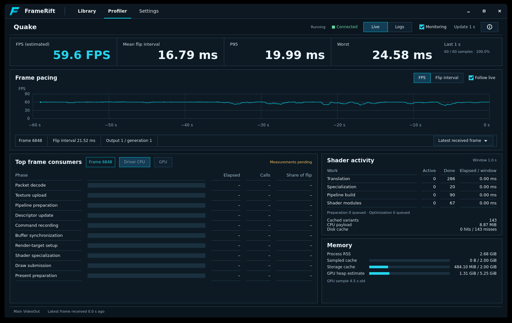
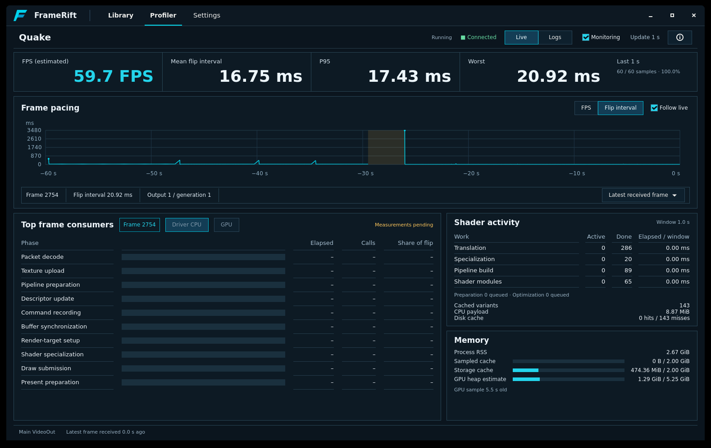
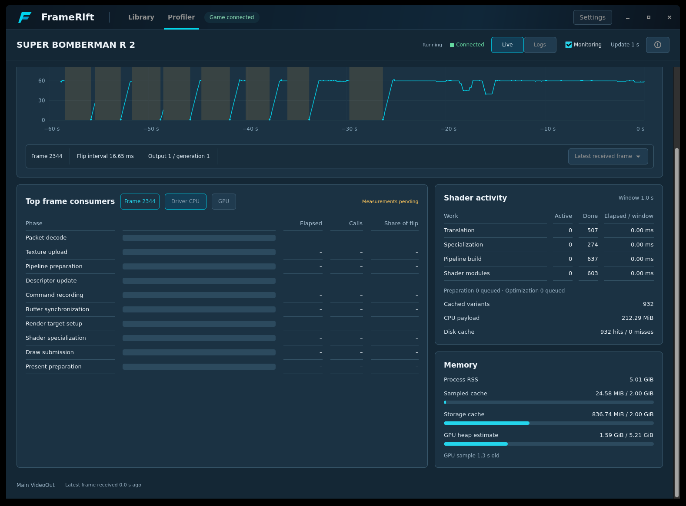
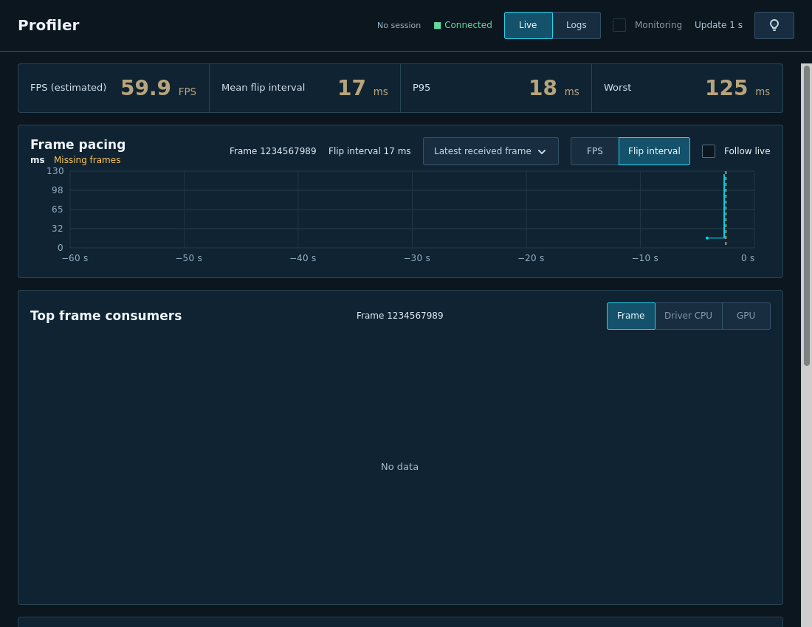
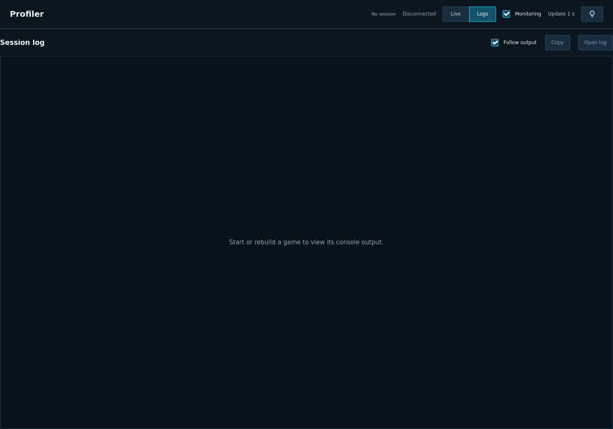
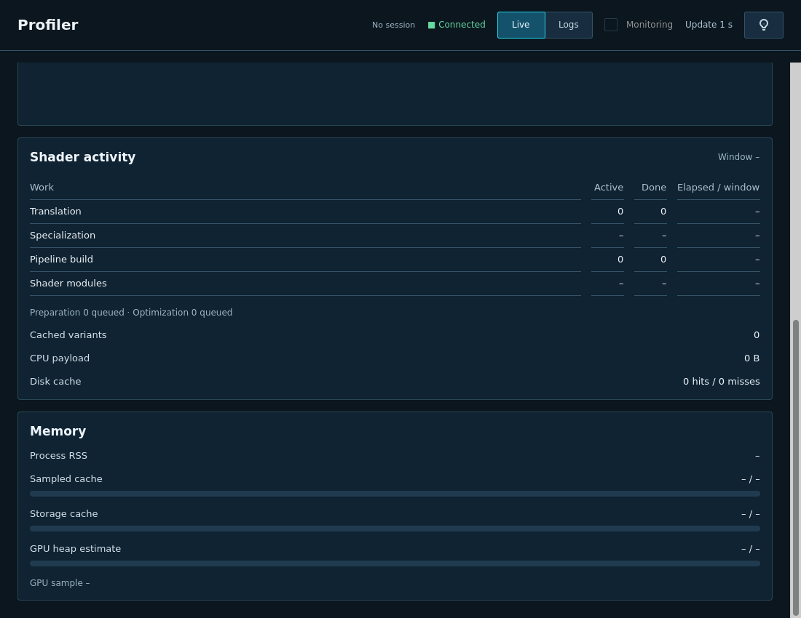
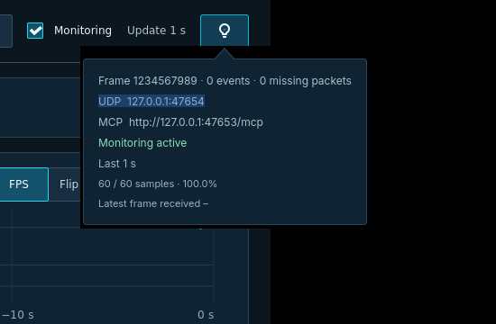

<!--
SPDX-License-Identifier: AGPL-3.0-or-later
Copyright (C) 2026 Michal Sytko and FrameRift contributors
Original project: https://github.com/MichalSy/FrameRift
Additional attribution terms: see NOTICE in the repository root.
-->

# Native profiler visual review

Reference: [profiler-live-v6](../assets/design/profiler-live-v6.png). The native workspace retains its layout, with the Library background and darker navy cards, restrained rounding and more generous spacing. The application owns the shared Library-style header; connection status sits beside Profiler, and Library search/refresh are hidden on the Profiler page. The Live content scrolls instead of compressing resource cards. The scrollbar uses a reserved lane at the right page edge, outside card padding, with overlay scrolling disabled. The earlier live screenshots below show real bridge observations, not example telemetry; consumer timing has no source yet and intentionally shows `–` and empty bars.

## Compact native preview

The current layout was checked in an isolated GTK window using the actual ProfilerView, synthetic layout fixtures and unavailable values. Fixture screenshots below are UI checks, not game measurements. The primary app and game were not restarted. Frame details and selection now occupy the chart header overlay, the FPS/Flip interval control shows both options with one active selection, and the overview values are smaller. The screenshots above belong to the previous live build.

## Visual direction

The original v6 implementation was manually assessed at 84/100 against its flat-panel concept. The current palette, 4 px card corners, more spacious rows and scrolling intentionally follow the newer requested styling. That earlier score is not a pixel-similarity claim for the revised appearance.

Cards use 16 px internal padding and 16 px section/column gaps. Shader work and cache rows have deliberate vertical spacing. Each memory label/value pair aligns across the card, with its budget bar on a separate full-width line. Numeric columns retain tabular digits, right alignment and stable overview widths.

## Verification

The chart header uses a native title/unit column with 8 px plot separation. Bottom axis labels end 6 px above the drawing-area edge, followed by the shared 16 px card padding. The consumer header centers its plain frame number independently of the left title and right-aligned Frame/Driver CPU/GPU segmented control. Unavailable CPU/GPU modes stay disabled. Its empty body shows “No data” with a 340 px minimum height; placeholder rows and the pending label are removed.

Live/Logs reuses the chart segmented control. The shared divider is drawn once and follows the selected side; screenshots verify complete outlines for both left and right selection. Native mouse clicks verify switching to Logs and returning to Live while preserving chart mode. The chart drawing area is 174 px high and the FPS axis is fixed at 0–75 with labels at 13, 30 and 60 and a native unit label beneath the title; interval mode still scales automatically.

The revised controls were inspected at 1500 × 1250 and 1100 × 850. Native allocation checks confirm the consumer counter is centered within 0.5 px, the segmented control reaches the header’s right edge and the empty body retains its 340 px minimum height at both widths. Both mode captions remain readable with a ten-digit frame ID and a three-digit worst interval. Native toggling confirms mutual exclusion and redraw in both modes. Follow live and Monitoring were checked on and off; the indicator allocation is 16 × 16 without inherited theme padding. Disabled controls remain distinct from enabled options. Narrow layouts stack the resource column; scrolling exposes the complete shader/memory cards without horizontal overflow. The top strip contains only the four metrics, with labels beside their values and smaller baseline-aligned units. It is about 20 px shorter than the stacked layout. Visible millisecond values round to integers, with full precision in tooltips; sample counts, coverage, observation-window state and receive age live in the Info popup. There is no footer. A stale/missing-frame badge beside the chart unit was checked at narrow width. All dashboard card containers share one factory and CSS class, 16 px padding/gaps and 4 px corners. Theme-independent button foregrounds are explicit.

- Native shell check: connection status remains beside Profiler on both pages; search and refresh are visible in Library and hidden in Profiler. Branding, Settings and window controls keep the shared shell styling.
- Native build succeeds (`cmake --build build -j2`); the previous workspace implementation also passed a full clean build.
- Bridge and game MCP checks pass. Added frame-rate checks cover 60 FPS, a 2.5 ms catch-up interval, a five-second stall, loss and epoch changes.
- Native scrolling checked at a shorter height. The right-edge scrollbar stays outside card padding, and scrolling reaches the complete shader/memory cards. A taller window keeps the same resource spacing.
- Native monitoring, FPS/interval toggle, selection/Follow live, Logs and Library navigation checked while the game continued running; session control used Codex FrameRift MCP.
- Done counters use process totals; inactive windows do not reset them. Elapsed uses the separately labeled observed window.
- Missing data uses `–`; actual zero memory remains `0 B`. Native telemetry does not manufacture example rankings or timings.

The runtime can still stall independently of the dashboard. A low flip rate or active/queued shader count of zero does not identify its cause; the UI reports observation age and available work evidence.
