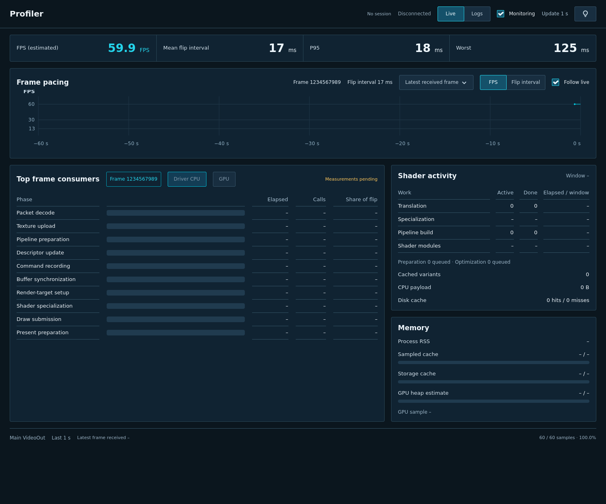

<!--
SPDX-License-Identifier: AGPL-3.0-or-later
Copyright (C) 2026 Michal Sytko and FrameRift contributors
Original project: https://github.com/MichalSy/FrameRift
Additional attribution terms: see NOTICE in the repository root.
-->

# Native profiler visual references

## Current layout

- Shared Library shell/background; connection beside Profiler; search/refresh only in Library.
- Compact metric strip, chart-header frame selection, FPS/interval controls and vertically scrollable resources.
- Navy cards, 4 px corners, 16 px padding/gaps, tabular right-aligned values; narrow windows stack columns.
- Consumer card centers the selected frame; unavailable CPU/GPU modes are disabled and body shows No data.
- Info popup holds diagnostics; stale/missing-frame state remains visible beside the chart unit.
- Reference concept: [profiler-live-v6](../assets/design/profiler-live-v6.png). Code: `src/ui/profiler.cpp`, `components.hpp`, `assets/ui/style.css`.

## Native layout fixtures

- These screenshots use synthetic layout fixtures/unavailable values; they are not gameplay measurements.
- [Wide controls](../assets/screenshots/profiler-controls-wide.png), [narrow controls](../assets/screenshots/profiler-controls-narrow.png).
- [Scrolled resources](../assets/screenshots/profiler-controls-resources.png), [Logs control](../assets/screenshots/profiler-logs-control.png), [Info popup](../assets/screenshots/profiler-diagnostics-popup.png).

## Real telemetry references

- Earlier native screenshots show genuine bridge observations with an older layout.
- [FPS](../assets/screenshots/profiler-live.png), [flip intervals](../assets/screenshots/profiler-flip-intervals.png), [resources](../assets/screenshots/profiler-resources.png).
- Check navigation, monitoring, selection/follow, scrolling and unavailable/stale states in native GTK; data checks live in `tests/bridge_check.cpp` and `tests/session_check.cpp`.
- Source/scopes and interpretation: [Profiler](profiling.md). Screenshot values are not an overhead benchmark.
