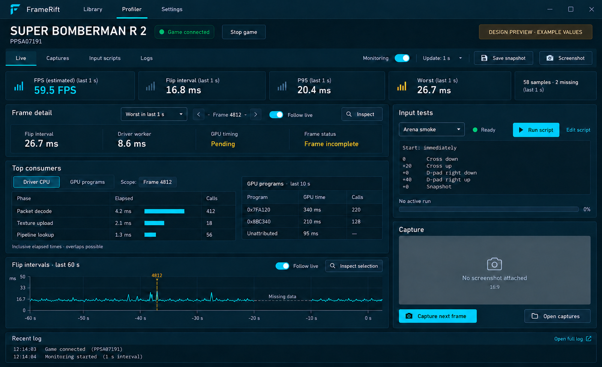
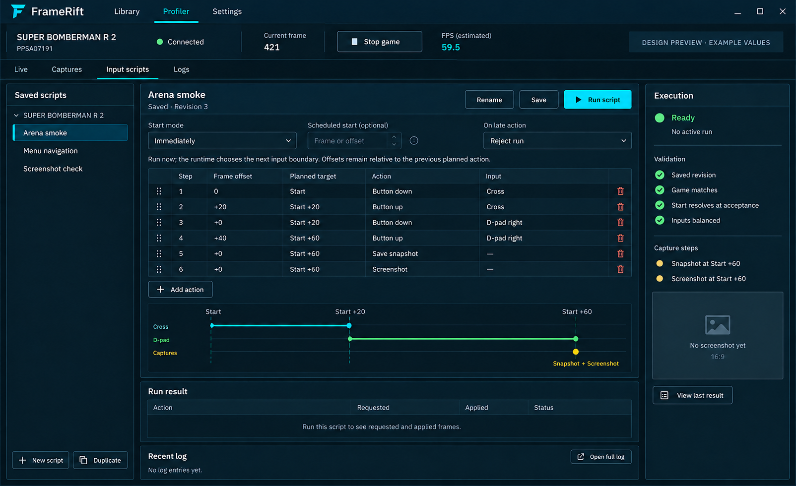

<!--
SPDX-License-Identifier: AGPL-3.0-or-later
Copyright (C) 2026 Michal Sytko and FrameRift contributors
Original project: https://github.com/MichalSy/FrameRift
Additional attribution terms: see NOTICE in the repository root.
-->

# Profiler workspace and game input scripts

This is a design and proposed integration contract. FrameRift currently has a console, game lifecycle tools and the receiving/command side of the bridge. AnyPS5 has an optional connection-only adapter; structured measurements, captures and saved input scripts are not implemented. This design does not add those capabilities. The reference images use example values, not measured gameplay.

## Workspace

The Profiler retains the current FrameRift header and selected game's metadata title. A session strip distinguishes process state, bridge connection and monitoring state. The workspace has four tabs: **Live**, **Captures**, **Input scripts** and **Logs**. The game continues in its existing external window; this layout does not depend on embedded rendering.

The current implementation priority is monitoring. The first increment uses **Live** and **Logs** only; add **Captures** when capture actions work. Input-script editing, execution and the script sidebar in the reference image are deferred. Use the freed sidebar width for frame details and the chart.



The Live view has a one-second overview, a selected-frame detail pane, top-consumer tables, a recent flip-interval chart, and a compact script/capture pane. The script selector offers **Run script** and **Edit script** for the current game. Logs remain a separate full console with a small recent-output strip in the Live view.

At smaller widths, the script/capture pane collapses into its corresponding tab. Tables retain their labels and units; the view scrolls rather than shrinking text. Session controls remain visible. Charts use quiet lines and explicit missing-data markers, not continuously animated backgrounds.

### What updates every second

One second is the UI refresh cadence. It does not delay input execution or require screenshots every second. The runtime pushes telemetry without waiting for FrameRift or MCP clients. The UI consumes buffered data and updates at most once per second while following live data.

The primary overview card is **FPS (estimated)**, followed by mean flip interval, P95 and worst interval, all scoped to **Last 1 s**. FPS is valid flip-completion interval count divided by their summed duration in seconds; it is not confirmed monitor scanout. P95 uses the nearest-rank percentile of received valid intervals; show its sample count. Missing frame samples require per-stream sample IDs and coverage metadata; packet gaps alone cannot establish them. Without that metadata, missing sample count is unavailable and packet gaps are shown separately. A partial window is marked partial and is not compared as a complete benchmark.

The detail selector offers **Latest received frame** and **Worst in last 1 s**. It always shows a concrete frame ID, output stream, sampling scope and completeness. GPU information may still be pending for that frame. Selecting a chart point switches to **Inspect selection** and keeps the frame stable; **Follow live** resumes selection updates. Inspecting or saving data never pauses the game.

If no valid frame arrived in the last window, show **No new frame data** and retain old values only as visibly stale. Missing measurements use **Unavailable**, **Pending** or **Incomplete**, never a synthetic zero. Last event age and loss counts remain available in session details. A disconnected adapter disables monitoring-dependent actions; existing process controls and logs still work.

### Useful live measurements

| Display | Meaning and scope | Existing source / bridge requirement |
| --- | --- | --- |
| FPS (estimated) and flip interval | Rate and intervals between runtime flip completions; not confirmed display FPS | Existing frame timing; structured per-frame export required |
| Frame/submission relationship | Frame ID, stream, submission range, flip packet, first execution and completion | Existing frame timing; preserve original identifiers |
| Driver worker elapsed time | Instrumented driver work and waits, with attributed/unattributed time | Existing timing scopes; not a complete game CPU sampling profiler |
| Top driver phases | Phase count, inclusive elapsed total, maximum and bytes where provided | Existing phase metrics; distinguish frame-local scopes from work completed between flips |
| Waits and preparation | Acquire, synchronization, upload, shader/pipeline work where separately instrumented | Existing scopes/counters; display actual scope names and coverage |
| GPU batches | Completed batch span, covered ranges, gaps and unread/dropped results | Existing delayed GPU accounting; not overall GPU utilization |
| Top GPU programs/classes | Program identity, command class, GPU duration, calls and unattributed duration | Existing roughly ten-second aggregates; a one-second/per-frame breakdown needs new attribution/export |
| Memory and caches | Device-local heap budget/usage, sampled/storage image cache bytes and budget | Existing memory-budget/counter paths; new structured samples required |
| Activity counters | Draw/dispatch counts, cache hits/misses, compile count/time and upload bytes when provided | Existing diagnostics/scopes; export only counters actually available |
| Diagnostics and capture status | Latest errors, exit status, event loss, requested/captured frame and artifact status | Process/log controls already work; capture producer remains required |

The default top-consumer table is **Driver CPU**, scoped to the selected frame when attribution is valid. A separate **GPU programs** table always labels its real aggregation window. Do not re-label a ten-second source as one second merely because the UI refreshes every second. Use raw program IDs/addresses until a verified name is supplied; scope addresses to their runtime session.

CPU scopes are elapsed, often inclusive and overlapping. Background preparation completed between flips is a window measurement. GPU spans can overlap CPU work and other spans. Tables can rank these durations; a single stacked "CPU + GPU = frame total" chart or percentage total would misrepresent them. Per-thread game CPU sampling, hardware GPU utilization, temperature and input-to-display latency are outside the initial data contract.

GPU results are read when available and linked to their original batch/frame, rather than forcing a GPU wait for the dashboard. Queue/time-domain mapping is required before drawing a shared CPU/GPU timeline. See [Khronos timestamp queries](https://docs.vulkan.org/samples/latest/samples/api/timestamp_queries/README.html). Runtime flip completion also does not prove display completion; [presentation synchronization](https://docs.vulkan.org/guide/latest/swapchain_semaphore_reuse.html) distinguishes these operations.

### Requirements for the later collector

The optional build/runtime bridge and its monitoring switch must preserve default AnyPS5 behavior. Reuse measurement hook locations, with independent counters: existing log reporters reset/exchange their own counters. Turning bridge monitoring on/off must not enable, suppress or consume the existing file/log measurements. Timing hooks still capture boundaries where work occurs; the bridge's worker transports already captured data. Use game-side monotonic timestamps, not UDP arrival times, for frame pacing.

Proposed data groups are per-stream frame summaries, delayed GPU batch results, interval-scoped cache/compile/transfer counters, memory samples with source provenance, and capture/run outcomes. Every sample identifies session, stream, measurement interval and coverage. External memory-guard scope memory is separate from Vulkan device-heap/cache usage. Whole-process CPU/RSS sampling is an additional source, not inferred from driver timings.

Keep queues and recent history bounded; the live chart initially retains up to 60 seconds with a memory ceiling that can evict older detail first. Preserve gaps and dropped-range counts. The receiver must consume telemetry continuously even when the visible dashboard repaints only once a second. No hot-path allocation, UDP send, file write or acknowledgement wait should be required to finish a frame. Detailed GPU measurement and screenshots need explicit measurement/capture modes and overhead verification.

## Snapshots and screenshots

**Save snapshot** stores an immutable copy of the selected measurement record and associated explicitly labeled aggregate windows. This is a local action on retained data and remains available after disconnect or process exit. Include session/game IDs, frame/stream, source and schema versions, enabled measurement mode, available build identity, timestamps, coverage and loss metadata. A partial snapshot remains marked partial; later data does not silently rewrite it.

**Screenshot** requests the next capturable frame, or a future absolute frame. Store requested frame, actual captured frame, output identity, dimensions, format and completion/error. A past selected frame can have a screenshot only if an image for it was already retained. A screenshot is not a full GPU debugger capture, a save state or deterministic replay.

Screenshot readback and encoding are asynchronous work with a visible **Requested / Capturing / Ready / Failed** state. A separate worker does not eliminate GPU copy/readback cost. Capture-related frames carry a marker so they can be excluded from performance comparisons. Continuous screenshots are not the default monitoring mode. Existing debug frame-dump readback/writer code is a possible starting point, but bridge queue saturation or write failure must return a capture error rather than throw or terminate the game.

Artifacts live below `<data-root>/logs/<game-id>/<session-directory>/captures/<capture-id>/`: a manifest, telemetry JSON and optional image. The Captures tab lists frame, type, scope, completeness and linked script run, with compare/export/open actions. It can compare compatible measurement snapshots without claiming that their screenshots were captured at the same frame unless both IDs match.

Pixels do not travel in the 16 KiB UDP envelope. For the local Windows/Linux bridge, a later adapter writes images asynchronously to a FrameRift-assigned session capture directory and sends an artifact ID and metadata. FrameRift resolves only its owned artifact directory; arbitrary received paths are not opened. Remote image transfer would need a separate future contract.

## Saved input scripts



Scripts belong to the selected game's profile and remain accessible after the game exits. Use a list with **New**, **Duplicate**, **Rename** and **Delete**, an editor for start mode and ordered actions, and a result pane. The Live view offers a quick selector; editing opens the same game-scoped editor. The game's library profile provides another entry point.

These are structured input sequences, not shell/Python programs. Version 1 proposes digital logical-pad buttons with explicit down/up, plus optional measurement/screenshot checkpoints when the runtime supports them. Axes, touch, branches and assertions need later contracts. Completing injected actions is labeled **Completed**, not **Passed** as a claim about game behavior.

### Durable storage

Store user-authored scripts in `<data-root>/profiles.sqlite3`, with all SQL and validation in `src/library`. Keep the current metadata database and generated code in their existing cache locations. Clearing the cache must not delete scripts. One proposed table is sufficient:

```text
input_scripts(script_id PRIMARY KEY, game_id, name, revision, definition_json)
```

Validate the stable game ID against the library when creating/running a script. Missing installations disable execution but preserve the definition. Saving increments the revision transactionally. A run uses an immutable saved definition/revision; editing a script does not alter an active run. Run manifests/results live at `logs/<game-id>/<session-directory>/input-runs/<run-id>.json` and refer to any capture IDs.

### Frame semantics

Start is optional. Omitting it means **Immediately**: install the fully validated sequence for the next available input boundary after runtime acceptance. This needs no numeric start frame and never executes actions already in the past. For planned runs, optional **After acceptance +N frames** and **Absolute frame 500** are supported. Relative offsets refer to the previous **planned** action, including releases and checkpoints. They never refer to packet arrival, actual late execution or a sleep on the UI thread.

Example saved definition (all names and enums proposed):

```json
{
  "schema_version": 1,
  "start": {"mode": "absolute", "frame": 500},
  "steps": [
    {"after": 0, "action": "button_down", "button": "cross"},
    {"after": 20, "action": "button_up", "button": "cross"},
    {"after": 0, "action": "button_down", "button": "dpad_right"},
    {"after": 40, "action": "button_up", "button": "dpad_right"},
    {"after": 0, "action": "snapshot"},
    {"after": 0, "action": "screenshot"}
  ]
}
```

This scheduled example resolves to **500, 520, 520, 560, 560, 560**. Remove `start` entirely for a spontaneous run, or use the equivalent `{"mode":"immediate"}`. Before acceptance, the editor then shows **Start, Start +20, Start +20, Start +60, Start +60, Start +60**; actual numeric targets arrive with the runtime's acceptance result. The optional `{"mode":"after_accept","frames":60}` waits 60 runtime frames from acceptance, with any preview explicitly estimated. The editor shows relative offsets and target expressions together; the scheduled-start field is disabled/collapsed in immediate mode.

The adapter must advertise one canonical primary VideoOut flip counter/stream and the boundary where logical input changes are applied, scoped to the runtime session. Report requested and applied frame separately. This schedules injection at a runtime boundary; observed flip IDs are not simulation ticks, and the game can read/react to injected input later. The exact input hook is an integration requirement, not an existing guarantee.

Reject a plan whose absolute start is already due/past before executing any step. A missed target after acceptance fails the run and releases automation input; do not silently catch up or shift later targets. Zero offsets allow chords on different buttons and capture checkpoints at the same frame. Preserve row order, reject conflicting transitions for the same button at that boundary, and require a neutral final input state.

Validate the whole plan before installing it: matching game/session, supported actions/buttons, nonnegative integer action offsets, positive `after_accept` delay, overflow-safe totals, balanced transitions and capability support for every capture checkpoint. A scripted snapshot needs a future checkpoint-data capability that reports the actual completed target frame; a screenshot checkpoint additionally needs `capture_frame`. These differ from saving an already retained local snapshot. Bound the initial contract to 128 steps and a complete serialized command of at most 16 KiB. Larger definitions are rejected before sending; there is no UDP fragmentation in this design.

Only one run owns logical pad 0 at a time. Ordinary controller/keyboard input resumes after the run; automation-held buttons are released on completion, cancellation, failure or game exit. A fully accepted finite sequence continues locally if FrameRift disappears, without waiting for network acknowledgements. Snapshot/checkpoint or image availability remains a separate reported result, not inferred from the input timeline.

### Running and observing

**Run script** uses a saved revision and the matching running game. Enable it only when the connected adapter supports the full action list. Unsaved edits use **Save and run**. Missing bridge/capabilities explain why execution is disabled; offline editing and existing game start/stop remain available. Launching a game is an explicit separate action.

FrameRift sends one `schedule_inputs` command with `run_id`, saved revision and complete definition. The runtime deduplicates command/run IDs within the session. `command_received` means receipt; `command_completed` for registration means the validated schedule was installed. Neither means the actions ran.

Proposed run events are `input_run_started`, `input_step_applied`, checkpoint/capture results and `input_run_finished`. Each carries run/session identity, step index, planned/applied frame and available error/artifact metadata. Capture steps enqueue work at their target boundary and never shift subsequent planned input actions. A progress event marks the input timeline finished while capture work remains; terminal `input_run_finished` is emitted after all accepted actions/captures have outcomes. The result pane distinguishes **Pending acceptance**, **Accepted**, **Running**, **Waiting for captures**, **Completed**, **Cancelled**, **Failed** and **Status unknown**. A complete result requires the requested actions and captures to have reported outcomes; cancellation can report abandoned outstanding captures.

Retain bounded runtime run summaries and add a capability-gated `get_input_run` command for recovery after lost events. This requires a later extension of FrameRift's current five-command allowlist; advertising the new capability alone will not make it executable today. `cancel_schedule` requests release/cancellation; the UI waits for a terminal run result. Missing UDP events or a disconnect produce stale/unknown observation, never inferred success. Run summaries contain actual applied frames and missing/outstanding outcomes for later inspection.

## Proposed MCP tools

These tools are not yet implemented. UI and MCP will use the same library definitions and runtime run manager.

| Tool | Arguments | Result |
| --- | --- | --- |
| `list_game_scripts` | `game_id`, optional bounded `limit`/cursor | Saved script IDs, names, revisions and structured definitions |
| `run_game_script` | `game_id`, `script_id`, `revision`, optional `start` override | Run ID, registration command ID, revision and initial state |
| `get_input_run` | `run_id` | Observed execution state, freshness, resolved/applied frames and capture references |
| `cancel_input_run` | `run_id` | Asynchronous cancellation command and observed state |

Requiring the revision prevents an AI from executing a definition changed since listing. Omitting the MCP `start` override uses the saved definition's optional start; if neither supplies one, execution is immediate. An explicit `{"mode":"immediate"}` override can run a normally scheduled script spontaneously. MCP does not accept executable paths or arbitrary code. Starting/stopping games and reading recent logs continue through the existing tools. Monitoring initially uses structured bridge events; a later normalized snapshot endpoint can share the UI's data model once that model is implemented.

## Integration order and verification

Start with one complete path from a successful AnyPS5 flip to genuine FrameRift FPS and interval values. A connected adapter currently sends no measurement events and advertises no command capabilities. Building the full mockup before this path exists would leave the dashboard without usable data.

| Increment | Deliverable | Completion evidence |
| --- | --- | --- |
| 1. Frame pacing | Independent frame summaries, monitoring toggle, Live/Logs, FPS/mean/P95/worst, selected basic frame and 60-second interval chart | Real game data reaches UI and MCP; OFF/ON, stale data and bounded loss behavior are verified |
| 2. Driver CPU consumers | Selected-frame phase count, inclusive total, maximum, waits and preparation with accurate attribution | Top consumers explain an observed slow frame without adding overlapping scopes into a false total |
| 3. Measurement snapshots | Save retained frame data and labeled aggregate windows locally; open/export through Captures | A snapshot remains readable after monitoring stops or the game exits |
| 4. GPU and memory | Delayed batch/program timings and memory/cache samples with real source windows | Pending/incomplete results and original frame/window attribution remain explicit |
| 5. Requested screenshots | Asynchronous capture command, status and owned artifact references | Requested/actual frame identity and capture overhead are visible; no continuous screenshot mode is required |

### First increment

- Reuse successful VideoOut flip-completion hooks and existing identities. Cancelled/closed-output requests must not count as completed frames. Preserve the existing `FrameTiming` ID for global correlation; it identifies flip work, not a simulation/input tick. Use session, output handle/generation and the existing completed-flip counter to identify stream samples. Define monotonic completion timestamp, valid interval and per-stream coverage before wiring the UI. The first completion after activation or stream reset establishes a timestamp and has no interval.
- Advertise `set_monitoring` only when the adapter implements it. Monitoring starts off. Show pending command acceptance separately from confirmed monitoring state; receipt alone does not establish activation. Continue connection heartbeats while monitoring is off.
- Record a small fixed-size sample at the frame boundary into a bounded nonblocking buffer; the existing bridge worker serializes and sends UDP. A full buffer drops measurements with visible loss accounting. Frame completion never waits for network receipt, command acknowledgement or file output.
- Keep this collector independent of `APS5_ENABLE_TIMING_LOG` and default file logging. Reuse measurement locations, not destructive reads of counters owned by existing log reports. More expensive CPU/GPU collectors are separate later increments.
- Normalize accepted samples in `src/runtime` continuously, with a 60-second time limit and a sample/memory ceiling. The current 512-event diagnostic ring is separate and includes other events; at 60 frame events/second it cannot supply a 60-second chart. Copy bounded presentation data to GTK rather than collecting through periodic UI/MCP event polling.
- Reuse the current Profiler view, game/session ownership and VTE log console. Render monitoring at most once per second with GTK labels/tables and a drawing area. Start with the four overview cards plus sample coverage, latest/worst frame selection and interval history; detailed CPU/GPU tables appear with their real producers.
- Distinguish connection, capability support, requested/confirmed monitoring and sample freshness. A hello without a frame shows **Unavailable**, not **Frame 0**. Preserve gaps, incomplete windows and stale last-session data after disconnect/exit. Reset measurement identity/history for a new session or output generation without mixing windows across them.
- Add a read-only normalized monitoring snapshot MCP tool using the same runtime data as Live. Existing bridge events and asynchronous commands remain available for diagnostics and control; AI clients should receive values, units, scopes, freshness and coverage together.

Verify known interval arithmetic and percentile selection over actual UDP reception, hello-only state, missing/reordered/duplicate samples, session/output reset, pending/off monitoring, buffer overflow and bounded history. Check that reception continues while another tab is visible and that disconnect/process exit preserves a visibly stale final observation. Finish with a native GTK smoke check and real-game UI/MCP observation. Compare monitoring OFF/ON with the same scene, settings and cache; the design image is not performance evidence.

Input scripts retain their proposed contract in this document, but their durable editor, schedule execution, status recovery, capture checkpoints and MCP tools follow the monitoring work. Their later checks cover requested/applied frames, late rejection, cancellation, saved revisions, cache clearing and capture association.

Current measurement semantics and source references are in [Profiling and frame analysis](profiling.md). Current transport/commands are in [Debug bridge and MCP](debug-bridge.md), and pad/input constraints are in [Controllers and input](controller-input.md). ImageGen prompts are saved with the [design assets](../assets/design/profiler-prompts.md).

### Local source anchors

The modified AnyPS5 checkout was inspected read-only for this measurement proposal. Relevant paths below are relative to that checkout, not files added to FrameRift. They describe existing instrumentation and possible hook locations, not implemented measurement/capture capabilities in the connection-only adapter.

| Concern | Source anchor |
| --- | --- |
| Inclusive frame metrics and delayed GPU attribution | `core/libs/prx/libSceAgcDriver/Execution/include/PerformanceTimer.hpp` |
| Flip completion interval | `core/libs/prx/libSceVideoOut/src/VideoOutDriver.cpp` |
| CPU presentation and draw phases | `core/libs/prx/libSceAgcDriver/Execution/src/Driver/Presentation.cpp`, `Execution/include/Driver/Draw/DrawTiming.hpp` |
| Timestamp ranges and ten-second GPU aggregates | `core/libs/prx/libSceAgcDriver/Graphics/src/Recorder.cpp` |
| Device-local budgets and caches | `core/libs/prx/libSceAgcDriver/Graphics/src/ShaderResources.cpp`, memory-budget query/cache update |
| External scope memory samples | `tools/run_with_memory_guard.py` |
| Readback and asynchronous BMP dumps | `core/libs/prx/libSceAgcDriver/Execution/src/PresentationScaler.cpp`, `Execution/src/VulkanDevice.cpp` |

Existing detailed frame collection depends on `APS5_ENABLE_TIMING_LOG`; GPU/draw profiling uses cached presence checks of `APS5_PROFILE_GPU` / `APS5_PROFILE_DRAW`. Setting those variables to `0` still enables them. Existing dump controls `APS5_DUMP_FRAMES` / `APS5_DUMP_FRAMES_EVERY` are not on-demand capture commands. A future bridge must expose independently supported capabilities and preserve these existing defaults.
